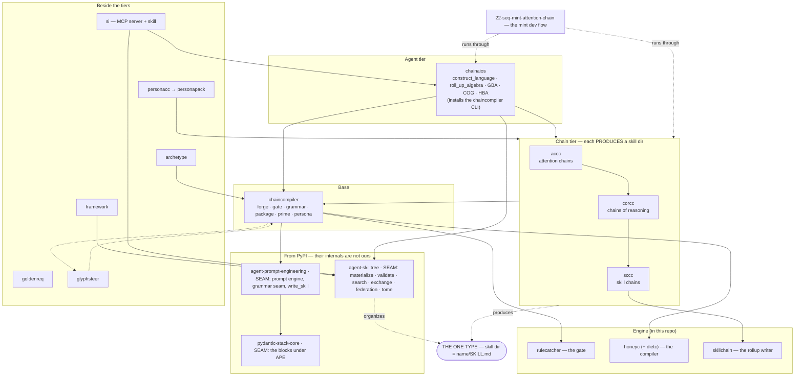
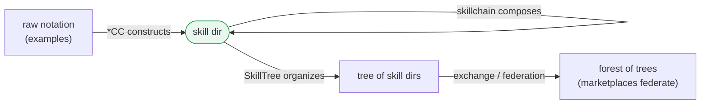
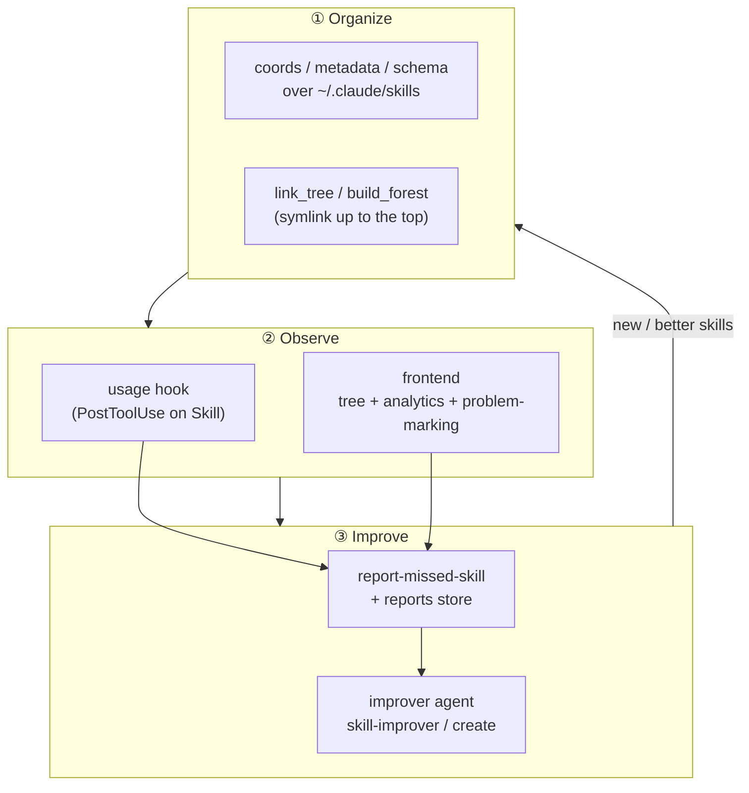
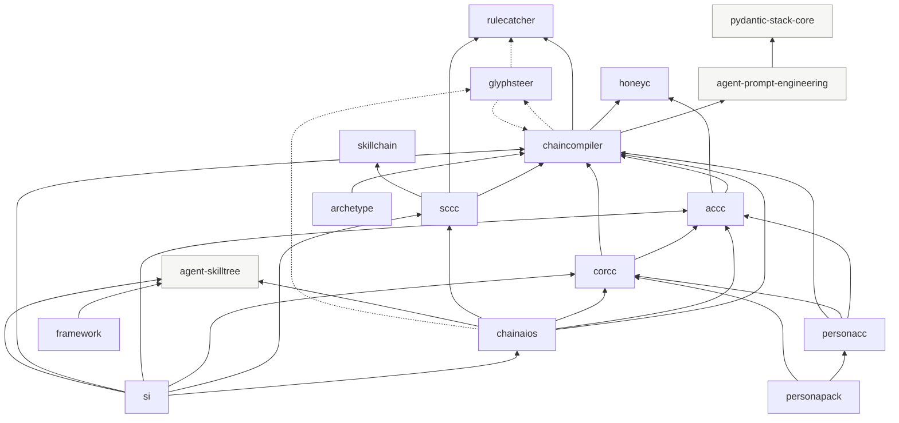

# Rule: ChainCompiler architecture — component diagrams

The static structure of the system. Every aspect has a component diagram here;
when you change the architecture, update the matching diagram in the same change.

The whole system is **a closed algebra over one type — the skill dir**
(`<name>/SKILL.md`, the unit any agent auto-loads). Every layer produces or
consumes only that type, so composition closes and recurses.

---

## 1. The full stack

Arrows = dependency (who imports whom). Drawn from `DESIGN.md` §2; every package is a box, and the
mint dev flow sits on the tiers it runs through.

---

## 2. The closed algebra (one type, three operations)

`*CC`s are **constructors** (lift notation into the type); `skillchain` is the
**composition operator** (closed: an SC can chain an SC); `SkillTree`/exchange/
federation are the **arrangement**. Validators do what the substrate won't.

---

## 3. Skill OS (P6) — three rings over the global namespace

The system **grows from its own gaps**: usage + reports feed improvement, which
feeds back into the organized namespace. Same closure, one ring higher.
Built: coordinates and the reports store (`report-missed-skill`). ASPIRATIONAL: the usage hook, the
frontend and the improver agent (`BACKLOG.md` P6).

---

## 4. Package dependency graph

Arrows point from a package to what it depends on (declared in its `pyproject.toml` and imported in its
source; dotted = optional or lazy).

The grey boxes come from PyPI; every other box is a package under `packages/`. `goldenreq` depends on
nothing. The dotted pair `chaincompiler` ⇄ `glyphsteer` is a lazy import cycle (each imports the other inside
functions), outside the contract and owed a break (`DESIGN.md` §2). `.importlinter` enforces the six-layer chain `chainaios > sccc > corcc > accc > chaincompiler >
prompt_engineering` (`DESIGN.md` §2).
