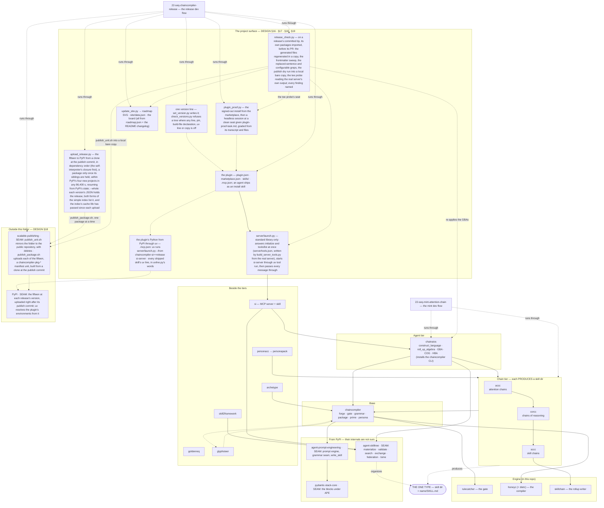
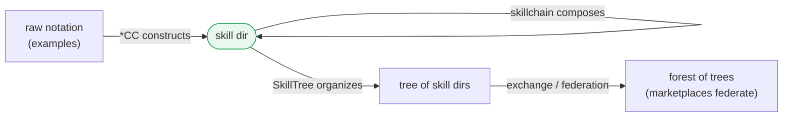
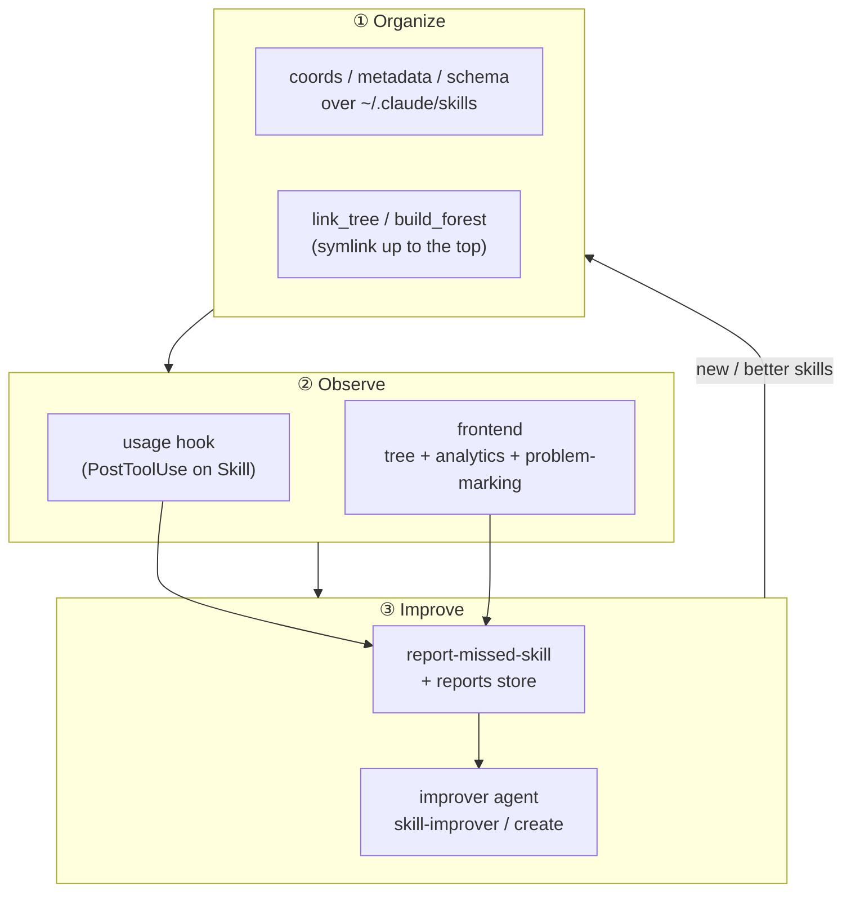
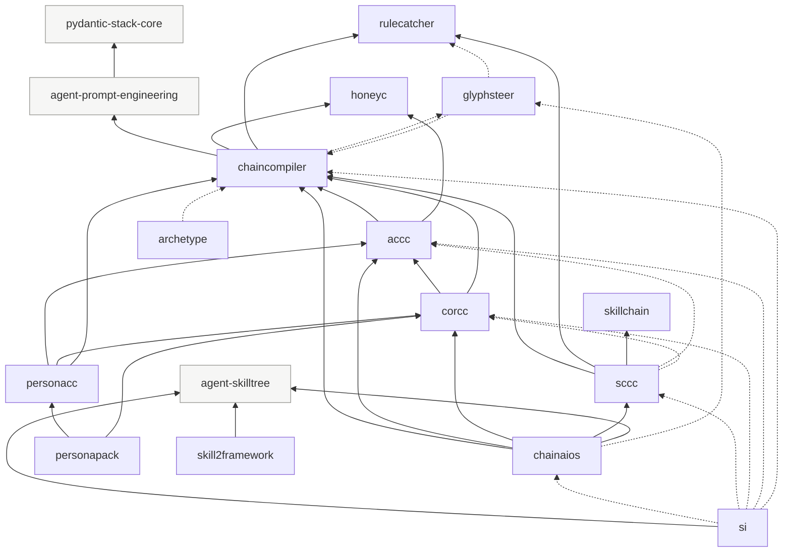
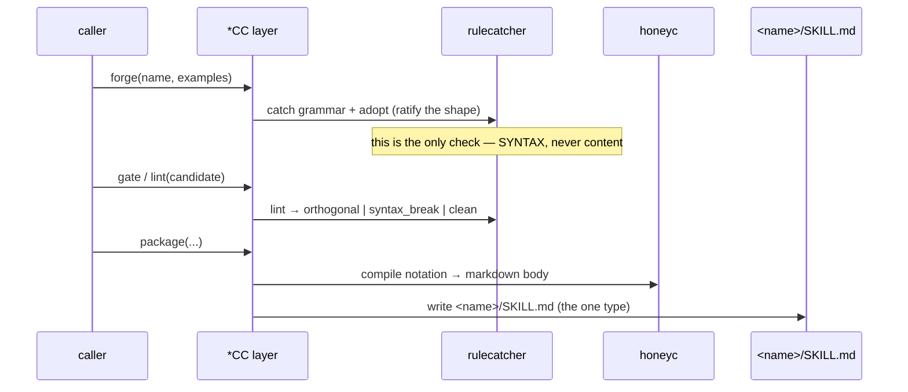
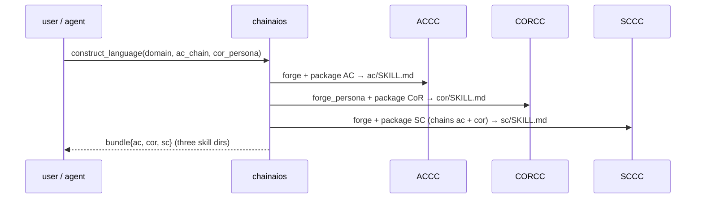
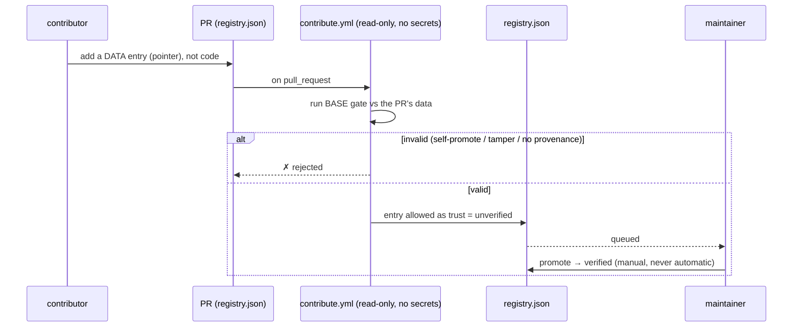
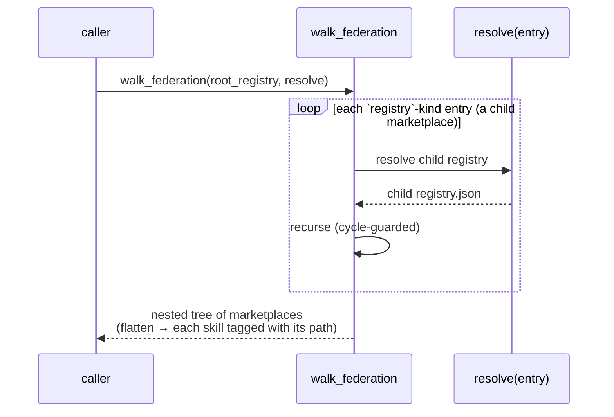
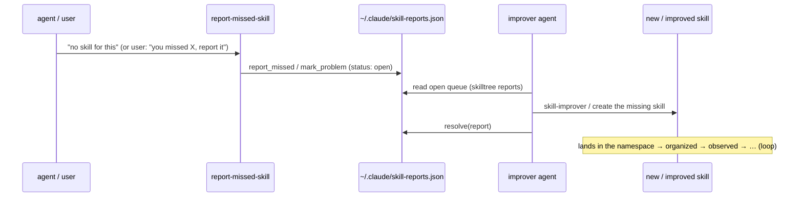

# 21 — THE STACK (ChainCompiler): the components and the flows

<docsys kind="arch-map" role="instance"/>

TRIGGER:[a change to `DESIGN.md` that adds, removes, renames or re-orders a layer, a package or an import edge (⇒
redraw §1 and §4 the same change) · a new dev flow (⇒ place it on §1) · a changed runtime flow (⇒ its sequence
diagram, §5–§10)]
DO:[draw every diagram from `DESIGN.md` · keep one diagram per altitude, a section each, in this one file · end
every external dependency at its seam · place every dev flow (`22-seq-*`) on the boxes it runs through]
NOT:[draw a box the design does not name · let the design and these diagrams disagree after any change]

The whole system is **a closed algebra over one type — the skill dir** (`<name>/SKILL.md`, the unit any agent
auto-loads). Every layer produces or consumes only that type, so composition closes and recurses.

---

## 1. The full stack

Arrows = dependency (who imports whom). Drawn from `DESIGN.md` §2 and §16–§18; every package is a box, and each dev
flow sits on the boxes it runs through.



---

## 2. The closed algebra (one type, three operations)



`*CC`s are **constructors** (lift notation into the type); `skillchain` is the
**composition operator** (closed: an SC can chain an SC); `SkillTree`/exchange/
federation are the **arrangement**. Validators do what the substrate won't.

---

## 3. Skill OS (P6) — three rings over the global namespace



The system **grows from its own gaps**: usage + reports feed improvement, which
feeds back into the organized namespace. Same closure, one ring higher.
Built: coordinates and the reports store (`report-missed-skill`). ASPIRATIONAL: the usage hook, the
frontend and the improver agent (`BACKLOG.md` P6).

---

## 4. Package dependency graph

Arrows point from a package to what it depends on (declared in its `pyproject.toml` and imported in its
source; dotted = imported only inside a function, a lazy import — declared as an optional extra when the build file
does not need it whole, `DESIGN.md` §18). Drawn from an AST walk of each package's `src/`, the walk
`scripts/check_versions.py` makes.



The grey boxes come from PyPI; every other box is a package under `packages/`. `goldenreq` depends on
nothing. The dotted pair `chaincompiler` ⇄ `glyphsteer` is a lazy import cycle (each imports the other inside
functions), outside the contract and owed a break (`DESIGN.md` §2). `.importlinter` enforces the six-layer chain `chainaios > sccc > corcc > accc > chaincompiler >
prompt_engineering` (`DESIGN.md` §2).

---

## 5. The compiler loop — how a `*CC` mints a skill

Every `*CC` (ACCC/CORCC/SCCC) runs the same loop on the engine.



---

## 6. `construct_language` — mint a whole domain language



---

## 7. SkillTree — surface up, then Read down (progressive disclosure)

A skill dir's nested `.claude/skills` is **not** auto-loaded (the scan is
non-recursive within `.claude/skills`). So entry points are symlinked UP to the
top, and the agent Reads DOWN the breadcrumbs (`02-the-autoload-mechanism.md`).

```mermaid
sequenceDiagram
    participant Dev as builder
    participant ST as skilltree
    participant User as ~/.claude/skills
    participant CC as Claude Code
    participant Ag as agent (session)
    Dev->>ST: materialize(tree, coords=True) + link_tree
    ST->>User: symlink root + branches (0-root, 0.1-…)
    Note over CC,User: session start → auto-loads ONLY the top entries
    CC->>Ag: available skills = root + first layer (coord-sorted)
    Ag->>Ag: Read the child's SKILL.md (its breadcrumb)  (= work in the child's folder)
    Note over Ag: on-demand load of that child's skills; leaves stay hidden until reached
```

---

## 8. Contribution gate — validate → queue → gated promote (P5)

The marketplace is a git repo; a contribution is a PR editing `registry.json`.
The gate is **fork-safe** and runs the BASE copy of itself, never the PR's.



---

## 9. Federation walk — a tree of marketplaces



---

## 10. The Skill OS loop — grow from your own gaps (P6)


