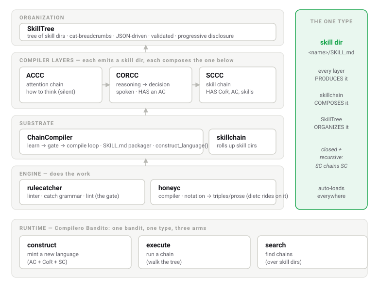
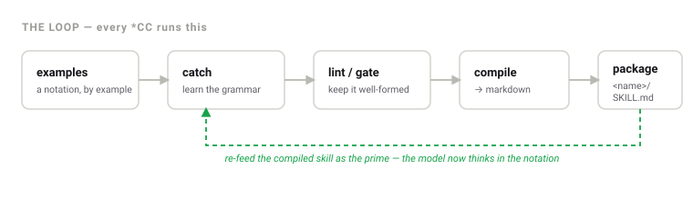
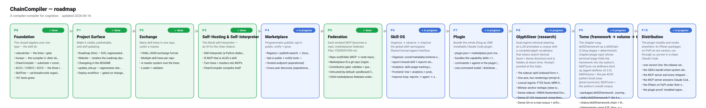
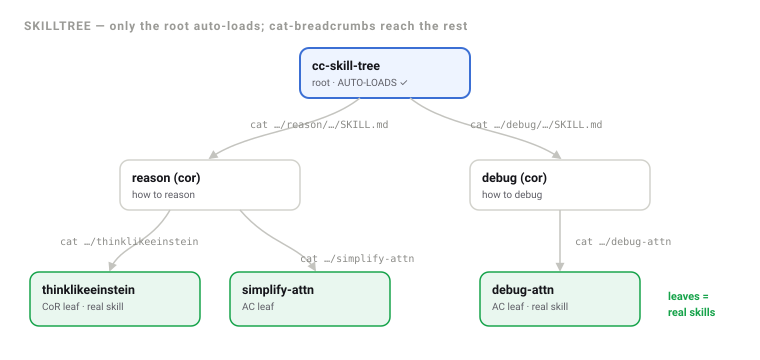

<div align="center">

# ChainCompiler

<!-- SCALABLE-PUBLISHING:AUTOGEN START (managed block — do not edit between these markers) -->

  

⭐ 0 stars • 🕑 Updated 2026-10-24

[Marketplace](https://github.com/sancovp/sancrev-marketplace) • [Docs](https://sancovp.github.io/aisaac/)

📦 Auto-published from the monorepo • [CHANGELOG](./CHANGELOG.md) • [sancovp/chaincompiler](https://github.com/sancovp/chaincompiler)

<!-- SCALABLE-PUBLISHING:AUTOGEN END -->

### A compiler-compiler for cognition.

*Define a notation. Gate it so the model never malforms it. Compile it into a universally-loadable skill. Compose those skills. Organize them into a navigable tree. Code validates every step.*

<br/>

**[★ GitHub](https://github.com/sancovp/chaincompiler)** · **[Live site](https://sancovp.github.io/chaincompiler/)** · **[🌼 The Hive Log](https://sancovp.github.io/chaincompiler/blog.html)** · **[Design](DESIGN.md)**

<br/>

    

<br/>



</div>

---

## Why

LLMs learn **in-context** — give the model a notation and it thinks in that notation. The hard part was never running one notation; it was *minting, checking, composing, and organizing* them reliably. ChainCompiler is the machine for that. The point isn't any single notation — it's the factory that produces them, with a linter at every seam so the model can't drift out of its own syntax.

> **It is all syntax, by design.** Nothing here judges whether a chain's *content* is good. The compilers guarantee **well-formed, composable, organized** artifacts. Correctness of thought is not their job — and that boundary is load-bearing.

---

## The one idea: a closed algebra over one type

Everything reduces to a single type — the **skill dir** (`<name>/SKILL.md`), the unit any agent auto-loads. Every operation produces or consumes only that type, so composition **closes and recurses**:

```
*CC            constructs   →  skill dir       (lift a notation into the type)
skillchain     composes     →  skill dir       (a skillchain OF skillchains)
SkillTree      organizes    →  skill dirs      (a navigable tree of them)
```

The `*CC`s are *constructors*, `skillchain` is the *composition operator*, `SkillTree` is the *arrangement*, and validators do the job the substrate refuses to.

---

## The loop — every `*CC` runs this

<div align="center">

</div>

---

## Roadmap

<div align="center">

</div>

**P0 Foundation** `✓` · **P1 Project Surface** `✓` · **P2 Exchange** `✓` · **P3 Self-Hosting & SI** `✓` · **P4 Marketplace** `▸` · **P5 Federation** `✓` ([plan](FEDERATION.md)) · **P6 Skill OS** `▸` · **P7 Plugin** `▸` · **P8 GlyphSteer** `▸` · **P9 Tome** `▸`

Full detail in **[ROADMAP.md](ROADMAP.md)** (live on the **[site](site/)**); concrete tasks in **[BACKLOG.md](BACKLOG.md)**. The image and the site are *generated* from [`roadmap.json`](roadmap.json) by [`scripts/update_site.py`](scripts/update_site.py) — edit the data, run the script, everything updates.

---

## The stack, layer by layer

<details>
<summary><b>🐝 rulecatcher</b> — the linter / gate <i>(the engine's left half)</i></summary>

<br/>

Learns a notation's grammar from examples (`catch`), then lints text against it (`lint`) with a two-axis verdict:

- **`orthogonal`** — a known token in the wrong slot → *steerable* (rotate it).
- **`syntax_break`** — a token foreign to the language → *fatal*.

This is the gate that keeps the model writing valid custom syntax. *(Vendored at [`packages/rulecatcher`](packages/rulecatcher) — zero deps, 43 tests.)*

```bash
rulecatcher catch examples.txt --scope mydsl
rulecatcher lint  newtext.txt  --scope mydsl   # non-zero on a violation → CI-gateable
```
</details>

<details>
<summary><b>🍯 honeyc</b> — the compiler <i>(the engine's right half)</i></summary>

<br/>

Parses the **Dense Rune-Chain** glyph notation (`🌸‍💧 → 🍯 → 🍹`) into an AST, then renders it through lenses: triples, Prolog, Cypher, prose. `dietc` (a modular-nutrition compiler) rides on top — proof that honeyc hosts arbitrary domain compilers.

```bash
honeyc norm   examples/mbr.rune
honeyc render examples/mbr.rune --as prose
```
</details>

<details>
<summary><b>⛓️ ChainCompiler</b> — the substrate + umbrella <i>(this package)</i></summary>

<br/>

Wires the linter + compiler into the `learn → gate → compile` loop and writes the result as a `SKILL.md`. The agent tier above the chain compilers, **`chainaios`**, adds the top-door `construct_language()`, the roll-up into closed chain systems and the agent shapes (GBA · COG · HBA), and installs the `chaincompiler` command. The whole design is [`DESIGN.md`](DESIGN.md).

```bash
chaincompiler layers     # print the stack
chaincompiler demo       # mint a whole 'triage' cognition-language in one call
```
</details>

<details>
<summary><b>🎯 ACCC</b> — Attention Chains <i>(the atom)</i></summary>

<br/>

An **attention chain** is *inner* — a silent template for **how to think** about something (a scaffold for a section or your thinking). Not necessarily spoken.

```rune
[Symptom] ⇒ [Repro] ⇒ [Hypothesis] ⇒ |Localize|
```

`forge()` mints a *new* AC language (the compiler-compiler move); `gate()` lints it; `package()` emits the skill dir.
</details>

<details>
<summary><b>🗣️ CORCC</b> — Chains of Reasoning <i>(spoken; HAS an AC)</i></summary>

<br/>

A **CoR** is a *spoken, paragraphical AC that makes a decision*. Same chain, two registers: the inner AC (silent) generates it; the outer CoR is the paragraph the model says. The lint is the only check — a malformed CoR means the model drifted out of syntax ("melting").

```rune
[Invariants] ⇒ [ThoughtExperiment] ⇒ [Simplicity] ⇒ |Reframe|   # ThinkLikeEinstein
```
</details>

<details>
<summary><b>🧩 SCCC</b> — Skill Chains <i>(the highest composite)</i></summary>

<br/>

An **SC** chains ACs + CoRs + **regular skills** into a sequence, rolled up into one `SKILL.md`. Because everything is a skill dir, an **SC can chain another SC** — the algebra closes.

```rune
[ac:debug-attn] ⇒ [cor:thinklikeeinstein] ⇒ [skill:summarize] ⇒ |Answer|
```
</details>

<details>
<summary><b>🌳 SkillTree</b> — the organization <i>(progressive disclosure in the filesystem)</i></summary>

<br/>

See the next section — it has its own diagram and a live example.
</details>

<details>
<summary><b>🐝 GlyphSteer</b> — dual-regime retrieval steering <i>(P8 research; the flagship)</i></summary>

<br/>

**What it is.** An LLM annotates a corpus with a *compiled, controlled glyph vocabulary*. Those markers steer retrieval in **two regimes at once** — **lexically** (a rare ASCII tag = a maximal-IDF exact-match facet) and **densely** (an emoji carries a learned direction that nudges the chunk's embedding) — and are then **stripped from the returned text** (the *sidecar split*: indexed-form ≠ returned-form, a hard, tested HIDE invariant). It is HoneyC pointed at the index instead of Prolog, and the cousin of Anthropic's *Contextual Retrieval* — but with a queryable, faceted controlled vocabulary instead of free text.

```
indexed-form  = clean_text ⊕ glyph_code   → embedded / FTS5-indexed   (MATCHING)
returned-form = clean_text                 → handed to the reader      (READING)
```

**The benefit.** The exact result you want is pinned to the top — without a smarter query — and the machinery never leaks into the output. **Measured lexical lift: MRR 0.417 → 1.000** on the toy sentiment-faceted corpus.

**Demo:**

```python
from glyphsteer import SENTIMENT, Chunk, RuleAnnotator, annotate_chunk, build_index, search

ann = RuleAnnotator.keyword(SENTIMENT, {
    SENTIMENT.by_name("negative").glyph: ["failed", "broke", "terrible"],
    SENTIMENT.by_name("positive").glyph: ["great", "excellent", "succeeded"],
})
chunks = [annotate_chunk(Chunk(c.id, c.text), ann, SENTIMENT) for c in corpus]
con = build_index(chunks)
hits = search(con, "deployment", facet=SENTIMENT.by_name("negative").glyph)
# hits[i]["text"] is CLEAN — the glyph steered the match but never reaches the reader
```

```bash
pip install -e packages/glyphsteer            # lexical regime, zero heavy deps
pip install -e 'packages/glyphsteer[dense]'   # + the dense regime
glyphsteer query corpus.jsonl "deployment" -f 😡
```

**Verified finding:** FTS5's `unicode61` tokenizer **drops emoji**, so one *axis* carries two renderings — an emoji `glyph` (dense direction) + an ASCII `tag` (lexical facet). The dense regime ships as an ONNX/fastembed Docker sidecar (no torch); Q1–Q3 are measured and the emoji-direction is real but **model-dependent** (`bge-en` collapses all emoji to one token; a byte-aware XLM-R model separates them). See [`packages/glyphsteer/README.md`](packages/glyphsteer/README.md).
</details>

<details>
<summary><b>🎭 archetype</b> — archetype as a state machine, compiled <i>(the thesis, applied to the psyche)</i></summary>

<br/>

An archetype is **not a noun** but a recursive individuation circuit
`⟨Persona, Shadow, Self, Odyssey, Becoming⟩`: `Shadow = DeniedInverse(Persona)`,
`Self = Integrate(Persona, Shadow)` (a *purified* Persona that bypasses the Shadow
fails **C2**), `Becoming = TypeLift(Self)`. `compile_archetype` infers the missing
aspects from one seed, builds the **multi-journey Odyssey** (a *succession* of hero's
journeys — call-out, one automorphism-encounter per pantheon member, a **post-return**
HJ), tests **quining** (orbit-closure), validates **C1–C6**, and emits Cypher / Prolog /
JSON / readable — or the one type via `emit_skill`. *You don't list archetypes, you
compile the transformation law.*

```bash
archetype compile Hero --substrate "example world" --depth 4 --emit all
archetype demo
```

The state-machine mechanics are G0-by-definition; the music↔archetype frame is a G8
resonance; whether the Becoming-cycle **closes or only tempers** (the comma) is the
open seam. Its spec, `ARCHETYPE-COMPILER.md`, is not yet published with this repo ([`DESIGN.md`](DESIGN.md) §12).
</details>

---

## SkillTree — a tree you Read your way down

Claude Code auto-loads **one layer** of `.claude/skills/` and **won't descend** into a nested `.claude` until you read into its folder. So the tree lives in **breadcrumbs**: each node's `SKILL.md` body names each child's `SKILL.md`, and Reading it (the Read tool — a shell `cat` loads nothing) injects that child's layer. Load one root, walk to the exact leaf you need — nothing else pollutes context. It's progressive disclosure implemented in the filesystem, **JSON-driven**, and **validated** (the platform never checks the breadcrumbs — so we do).

<div align="center">

</div>

<details>
<summary><b>The real <code>cc_tree_test</code> — on disk</b></summary>

<br/>

```
cc_tree_test/
  .claude/skills/cc-skill-tree/SKILL.md          ← root (the ONLY thing that auto-loads)
  reason/.claude/skills/reason/SKILL.md
  reason/thinklikeeinstein/.claude/skills/thinklikeeinstein/SKILL.md   ← real CoR leaf
  reason/simplify-attn/.claude/skills/simplify-attn/SKILL.md
  debug/.claude/skills/debug/SKILL.md
  debug/debug-attn/.claude/skills/debug-attn/SKILL.md                  ← real AC leaf
```

The root's body — the breadcrumbs:

```markdown
## Descend — the next layer (2)
Only this layer is loaded now. To descend, use the **Read tool** on a child below — that injects the child's layer (its persona + skills). …

- reason (cor): Read `reason/.claude/skills/reason/SKILL.md`
- debug (cor): Read `debug/.claude/skills/debug/SKILL.md`
```
</details>

```bash
skilltree build cc_tree_test.manifest.json cc_tree_test   # JSON → tree, then validate
skilltree validate cc_tree_test                            # every breadcrumb must resolve
```

The manifest is the org chart — **edit it however you want, rebuild, and every breadcrumb + dir regenerates.**

---

## Quickstart

```bash
# install every package in the monorepo, editable — rulecatcher included.
# one clone, one command, no external setup.
./install.sh            # pip install -e packages/* (no-deps)

python3 examples/_all/run_all.py   # ⭐ THE everything example — one domain through 10
                                   #    packages, end to end: persona → honeyc → gate →
                                   #    construct → tree → steer → interpret.
                                   #    16/16 checks; the closed algebra, dogfooded.

chaincompiler demo      # construct a 'triage' language: AC + CoR + SC in one call
sccc        demo        # chain an AC + CoR + skill into one SKILL.md
skilltree   demo        # build a breadcrumb tree, walk it, break a crumb → caught
```

> **[`examples/_all`](examples/_all)** is the dogfood: not ten isolated demos, but
> **one artifact built by all ten tools in sequence** — proving every operation
> produces or consumes the same type (a skill dir), so the algebra actually closes.

```python
import chainaios
from corcc.notation import EINSTEIN
bundle = chainaios.construct_language(
    "triage",
    ac_chain="[Symptom] ⇒ [Scope] ⇒ |Severity|",
    cor_persona=EINSTEIN,
    db=".cc.db", skills_dir="skills", out_dir="dist",
)   # → bundle.ac / bundle.cor / bundle.sc  (three SKILL.md packages)
```

---

## Repo layout

```
chaincompiler/                 # the monorepo (this repo)
  DESIGN.md                                      # the design, one section per part — read first
  README · ROADMAP · BACKLOG · roadmap.json      # project surface (the changelog is below)
  assets/ · site/ · scripts/ · .github/          # roadmap SVG, site, generators, workflows
  skills/ · .mcp.json · .claude-plugin/          # the plugin payload
  personas/ · examples/ · chains/                # worked agents · end-to-end examples · skillchain specs
  packages/
    rulecatcher/   honeyc/   skillchain-compiler/  # the engine (rulecatcher: zero deps)
    chaincompiler/                                 # the base
    accc/   corcc/   sccc/                         # the chain tier
    chainaios/                                     # the agent tier (owns the `chaincompiler` CLI)
    personacc/   personapack/   goldenreq/   glyphsteer/   archetype/   framework/   si/
```

`./install.sh` wires every package editable. **SkillTree** is published standalone on PyPI as
**[`agent-skilltree`](https://pypi.org/project/agent-skilltree/)** (the bare name `skilltree` is taken by
an unrelated package) — import name stays `skilltree`; `install.sh` pulls it. Everything else is vendored
in `packages/`.

---

## The formal spec

```
SKILL_DIR   IS A <name>/SKILL.md            (self-describing, auto-loadable)
AC          IS A attention-template          (how to think; inner, silent)
COR         IS A spoken AC that decides       →  COR HAS AC
SC          IS A sequence                      →  SC HAS COR, AC, skills
*CC         IS A syntax compiler               →  *CC PRODUCES SKILL_DIR
skillchain  PRODUCES SKILL_DIR from SKILL_DIRs (composition closes)
SkillTree   IS A tree of SKILL_DIRs            (wired by Read-breadcrumbs)
BANDIT      IS A ChainSelector                 (the default COR: select vs construct)
BANDIT      PRODUCES BanditChainSystem         (roll up AC→COR→SC, CLOSE it → a domain persona)
BanditChainSystem  HAS KB, GlyphSteer-self-improve  (the persona builds + reads itself better)
hierarchicalize    PRODUCES SelfView           (BANDIT rolls the move over its OWN parts → granular self)
```

---

## Changelog

### v0.1.64 — 2026-10-24
- **The public repository's two bug sweeps are home.** The fourteen defects its branches `fix/bug-sweep` (pull request
  #1) and `fix/confirmed-bug-sweep` (#2) found are fixed here, at every door the same input reaches, each with a
  regression test that fails without its fix; where the two fixed one defect two ways, the fix `DESIGN.md` states is
  kept. **honeyc:** the readable lens writes each relation back in the spelling it read (`-rel->`, `<rel-`, `<rel>`),
  and the spelling is no part of a term's identity, so a transform's id is what it was; a relation an author names
  `mediates` no longer crashes the triples and prose lenses, the emitters or `honeyc norm` (`normalize.is_mediation`
  tells it from an inferred mediator); `check` descends into assignments and transforms, and suggests the whole chain,
  in its source spelling, with the mediator bounded — what it suggests parses back to the chain's statements plus the
  bounding; the Prolog declares its base rules' predicates and closes `linked/2` with a visited list, so a false query
  fails, on a program with no equivalence too, and an open one enumerates every node. **dietc:** a safety field it does
  not know is kept as a note instead of crashing the load; the rune block writes the day's gaps, and each of its steps
  as a scope holding its chain, never `[Step]:Term`, which the grammar reads as a type; the rune writes its cap watch as
  a relation the grammar reads. **glyphsteer:** one matcher, the longest glyph first and never two that overlap, under
  every reader, so a glyph and its variant (`⚠`, `⚠️`) parse, strip and hide-check whole; `strip` removes the
  separator's space and repeats until nothing is left to remove; `to_honeyc` keeps the code's order; `merge` keeps the
  last author on a tag clash and every entry that clashes with nothing; `lint` refuses foreign content and names it; a
  query with no word finds nothing; the vacuous grade-sort test asserts the order. **The search doors:** `si_search`
  and `chaincompiler gba search` send SkillTree's search the query's words alone, so neither raises on a query with no
  word or on an operator word (`NOT`) — SkillTree's own search still does (owed upstream, `DESIGN.md` §10). **corcc:**
  the CoR directive has its verb ("a paragraph that performs, in order, N moves").
- **One reading of the notation.** honeyc's README `Core notation` table gives every marker the grammar defines its
  reading, an example and the triples it gives; `tests/test_readme_notation.py` checks every row against the code,
  every grammar marker against the table, and the README's core example against what it prints. `-rel->` and `<rel-`
  are two spellings of `rel(A, B)`.
- **Every committed CoR compiled again** through its generator — the two style chain systems, the two personas' GBA
  bodies, bigdog, and outside this folder CompiloApe's tower, agent-rts's WoomEngineer system, three host forks and the
  host template's three CoRs. Their generators' descriptions are colon-free, so every frontmatter parses. The plugin is
  0.2.4, since its payload changed; the shipped glyphsteer skill says `lint` refuses foreign content.
- **No distribution takes another project's PyPI name.** `accc`, `archetype` and `si` are distributed as
  `chaincompiler-accc`, `chaincompiler-archetype` and `chaincompiler-si`, `skillchain` as `skillchain-compiler`, and
  every build file names them so; import names are unchanged, and `install.sh` installs by folder as before
  (`DESIGN.md` §18). An environment `install.sh` built before keeps the old names' records — build it again. Owed, by
  the author's ruling: the fifteen published to PyPI under these names.
- **What the author keeps out of the public repository is folded home**, outside this folder: the steward package is
  its own project, and the internal design, the history of the public repository from before its rewrite and of its
  two bug-sweep branches, and the two files of that history held nowhere else are in `not-unified/chaincompiler-internal`
  (`DESIGN.md` §18). Owed: the three public branches closed.
- The sweeps' noted findings: rulecatcher's merged snapshot import can leave a rule's status and its history
  disagreeing — owed, `DESIGN.md` §3; `scripts/promote.py`'s path insertion was already gone; the tokenizer's dead
  branches are removed. Also owed and boarded: bigdog's build writes its build time into the scope it exports
  (`DESIGN.md` §16); SCCC can resolve a step to the organizing tree's node copy (`DESIGN.md` §5).
- Suite: 313 passed (`pytest packages`; 70 new). `honeyc` 0.1.1 · `glyphsteer` 0.1.1 · `corcc` 0.1.1 ·
  `chaincompiler-si` 0.1.1 · `chainaios` 0.1.2 · `rulecatcher` 0.1.2 · `chaincompiler-accc` 0.1.1 ·
  `chaincompiler-archetype` 0.1.1 · `skillchain-compiler` 0.1.2 · `personacc` 0.1.1 · `sccc` 0.1.1.

### v0.1.63 — 2026-10-24
- **The design says where the unpublished work lives, and what the public repository's branches still owe.**
  `DESIGN.md` §18: a branch of the public repository is never merged there — its work is ported to the source home and
  the branch closed; the folder holds only what publishes, and what the author keeps out of the public repository
  lives in the source home outside it — the steward package, which the release pass removed, as its own project, and
  the internal design and the history from before the public repository's rewrite beside it. Owed: the public
  repository's two bug sweeps (its pull requests #1 and #2: fixes, each with a regression test, for defects in honeyc,
  dietc, glyphsteer and corcc) and the backup of the history before the rewrite never reached the source home.
- **One reading of the notation.** `DESIGN.md` §3: each user's notation is that user's own configuration, and this
  repository's own states one reading of every marker its grammar defines — `A -rel-> B` and `A <rel- B` are two
  spellings of `rel(A, B)`, `A <rel> B` states it both ways, and the readable lens writes back the spelling it read.
  Owed: the README's table calls `<rel-` the reverse and gives no reading for `⟶` or `⟼`, and the readable lens writes
  both spellings as `<rel`, which does not parse.
- **Glyph matching.** `DESIGN.md` §11: a vocabulary may hold a glyph that is part of another; matching takes the
  longest glyph first and never two that overlap. Owed: it matches by substring today.
- `DESIGN.md` §0: a question only the author can answer is a `BACKLOG.md` task marked as the author's call.
  `BACKLOG.md`: five tasks for that work, and a P8 section with its open roadmap item. No code changed; suite: 243
  passed.

### v0.1.62 — 2026-10-24
- **ChainCompiler's agent, CompiloApe, is built.** `DESIGN.md` §20 states its delivery as built: a persona of this package's operations (Forge → Gate → Package → Compose → Arrange → Validate → Place) seated by `make_gba` over five minted chains, its plugin's install wizard installing this package from a checkout through `./install.sh`, and a skill a host calls to hand the installed agent a task and get back what it made.
- **The GBA's default rule blocks are public: `chainaios.default_rule_blocks(domain)`.** `rule_blocks=` replaces the four defaults (the loop, the law, the reward record, self-expansion), so an agent adding a block of its own extends them — `{**default_rule_blocks(domain), "<its own>.md": …}` — and every rebuild writes all of them again. The HBA and the nutrition example use it in place of the private `_rule_blocks`.
- **`chaincompiler gba check <root>`** (`chainaios.check_gba`) reads `closed` again on disk at any time: every body the manifest names present; the materialized tree (`skilltree.json`) having the manifest's shape and validating with zero violations; every `SKILL.md` in the folder a node of that tree or the `bandit-chain-system` copy, so a skill written into it by hand is listed as unlisted and the GBA is not closed; every `SKILL.md`'s frontmatter parsing. It exits non-zero when any fails. An agent made inside the folder is checked on its own. `make_gba` reported `closed` only once, at creation.
- **A compiled skillchain no longer carries its compile date**, so one sequence compiled on two days gives the same bytes. The five committed rollups that carried one — the two style chain systems, `skill2framework`, and the roots of the two personas — are compiled again without it, and the personas re-applied; the plugin is 0.2.3, since three of them are in its payload.
- Found and owed (`DESIGN.md` §8, `BACKLOG.md`): a rebuild deletes and rewrites the root folder, so a shell standing in it loses its working directory; and `gba check` does not compare a materialized body with its source.
- Suite: 243 passed (`pytest packages`; three new `chainaios` tests: the defaults extended and kept across a rebuild, the check refusing a missing body and a broken frontmatter, and the check refusing a skill outside the tree and a tree that is not the manifest). `chainaios` 0.1.1 · `skillchain-compiler` 0.1.1.

### v0.1.61 — 2026-10-24
- **ChainCompiler's agent is CompiloApe.** `DESIGN.md` §20 now names CompiloApe (`base/compiloape` in the source home) as ChainCompiler's own agent — a separate project and a plugin of its own that depends on this one, climbing SkillTome's agent ladder through these doors — and states how a host Claude makes use of it: through a skill its plugin carries, which hands the installed agent a task and returns what it made, never seating the agent's persona in the host. v0.1.60 had named the host AIOS.

### v0.1.60 — 2026-10-24
- **The design names ChainCompiler's agent and how it is delivered.** `DESIGN.md` §20: ChainCompiler's own agent is the host AIOS, a separate project and a plugin of its own that depends on this one. Its folder is forged through these doors (a persona of these operators seated into a GBA by `make_gba`, its chains minted by the chain compilers), and it climbs SkillTome's agent ladder — the folder, its agent definition, the launcher, that plugin, and the install wizard that teaches a base Claude to install all of it.

### v0.1.59 — 2026-10-23
- **A board, generated from the roadmap.** `scripts/update_site.py` now also writes `.claude/rules/chaincompiler_states.md`: one row per `roadmap.json` phase, its status marked across PLANNED → IN PROGRESS → DONE, each row pointing at `BACKLOG.md`. `roadmap.json` stays the one source; `deploy.yml`'s staleness check now covers the board as well as the site and the SVG, and also fails on a generated file that was never committed.
- **The design states how the plugin delivers an agent.** A plugin install loads no root `CLAUDE.md`, so the plugin carries none; an agent it delivers ships as an install skill whose resources hold the agent's `CLAUDE.md`, and whose script makes a new folder, named by whoever installs it, holding that `CLAUDE.md` and the rules and skills the agent needs (`DESIGN.md` §16, §20).
- **One stack file.** The component diagrams (`10-architecture-components.md`) and the sequence diagrams (`20-architecture-flows.md`) are one rule, `.claude/rules/21-architecture-diagrams.md`, a section per altitude, every diagram kept; the stack gains the project surface and the publish seam, so the release flow sits on the boxes it runs through.
- **How a release is cut is now a rule.** `.claude/rules/22-seq-chaincompiler-release.md`: edit only the source home, fix the generator rather than its output, regenerate every generated file (the board included), make every copy of a shipped skill one, cut one version everywhere a version lives, keep the backlog without deleting work, and prove the release on a clean install of what the publish pipeline would put in the public repository.

### v0.1.58 — 2026-10-23
- **The two personas' root skillchain packages are their originals.** v0.1.57 tracked a recovered `SKILL.md` for each root (`personas/.chainforge.src/dist/diagram-construction/`, `personas/.systemic-archive-narrator.src/dist/adam-curtis-narration-style/`), rebuilt from the body the committed tree carries; its frontmatter differed from the original, which a checkout holding the ignored original then overwrote. Each `SKILL.md` is now exactly what `skillchain` wrote — its name and description from the `chain.json` beside it, which is tracked too. `.gitignore` un-ignores only those two folders; every other `dist/` output stays ignored. Both personas rebuild byte for byte from a clean checkout.

### v0.1.57 — 2026-10-23
- **ChainCompiler has a design: [`DESIGN.md`](DESIGN.md).** One section per part, in dependency order — the one type, the layers, the engine, the base, the chain compilers, personas, the agent tier and its shapes, goldenization, organization, retrieval steering, the archetype compiler, the chapter rung, the self-interpreter, the marketplace, the plugin, the project surface, publishing, the tests, and the agent that knows ChainCompiler. No design document existed before, while the code cited one (`DESIGN.md §3, §10 stage 1`, …) and a `META-APE spec §3` that is not in this repo; every such citation now points at a section of `DESIGN.md`. `REBUILD-SPEC.md`, `FEDERATION.md` and `DIETC-AIOS-REBUILD.md` are marked reference detail for the sections that own them, and the README, the orientation skill and rules 00/01/02/10/20/22 agree with it — the component and package diagrams are redrawn from the real imports, including the one lazy import cycle (the base's `persona` ⇄ glyphsteer), now listed as owed.
- **Everything the agent tier generates agrees with the design.** Every GBA and HBA rule files a goldenization request (`goldenreq`) when a chain earns 🏆 twice — the generator had kept telling each agent to promote its own chains — and every generated instruction descends by Read, never `cat` (the GBA loop rule, the COG role and flow, the HBA select-agent, whose start path now names the real root `0-<domain>`); the `bandit-chain-system` skill in all four copies imports from `chainaios` and says the same; the two committed personas are regenerated from the fixed generator.
- **A GBA never rebuilds over a missing body.** `construct_into` and `_apply_tree` refuse when a gated body is missing, where they had silently written a stub and still validated clean; the two personas' root bodies are tracked (they sat in `.src/dist/`, ignored as `dist/`, so a clone lost them), and both personas rebuild byte for byte from a clean checkout.
- **The examples run again.** `examples/_all/run_all.py` — the everything example — and `bandit_self.py` called `construct_language` / `roll_up_algebra` / `hierarchicalize` on `chaincompiler`, which stopped exporting them when the agent tier moved to `chainaios`; the published `run_all.py` failed at stage 4. `examples/nutrition` imported `chaincompiler.gba` and predated the portable `gba.json`.
- **si:** a walk resolves each relative breadcrumb at its node's folder (SkillTree ≥0.4.0 writes them so; it had resolved them against the working directory and stopped one level down), and `read_skill` finds a skill in a coordinate-addressed tree (folders named `<coord>-<name>`). Each fix has a test that fails on the old code.
- **The plugin:** `skills/report-missed-skill` and its dev-surface twin were symlinks into `packages/skilltree/`, removed on 2026-06-27, so the plugin shipped a broken skill; restored byte-exact from this repo's history. Version 0.2.2 (the payload changed, and an installed plugin updates only when the version moves); its description lists what it ships. Every generated description is colon-free — the capability generator, the roll-up's tree descriptions and bigdog's build had each written one SkillTree or APE cannot quote — so all 113 `SKILL.md` parse, and each committed output equals what its generator writes.
- **BACKLOG and the rest:** the BACKLOG names every defect `DESIGN.md` marks owed; no home-relative path to the author's folders remains (personapack's provenance and receipts name the private repository, rule 02's evidence names a test project); `scripts/promote.py` imports SkillTree from the installed package; the `skilltree` dev skill is a copy of SkillTree's own.
- Suite: 240 passed (`pytest packages`); `examples/_all` 16/16, `bandit_self` 7/7, `examples/nutrition` 2/2 and the import contract kept — in a fresh environment built by `./install.sh`.

### v0.1.56 — 2026-10-23
- **A clean install now gets everything.** `install.sh` installs the packages with `--no-deps` and names their outside dependencies by hand; that list lacked `lark` and `pyyaml` (honeyc), `click` (every CLI) and `fastmcp` (the si MCP), so a clean clone in an empty environment could not import honeyc — 17 test modules failed to collect. Found by the first clean-install test of the published repo; every non-optional dependency the packages declare is now installed. The same test found three packages `install.sh` never listed — `personacc`, `personapack` and `goldenreq` — so they are installed too, and goldenreq's ninth test (which needs `personacc`) passes. The plugin description no longer asks for a separate `pip install fastmcp`.

### v0.1.55 — 2026-10-23
- **Every generated file is portable — no machine's path anywhere in the folder.** The generators were fixed, then their output re-made: `chainaios.gba` stores `gba.json`'s `skill_src` relative to the AIOS root (resolved back on read, so `construct_into` keeps building) and writes each lord's way UP as a path relative to its own folder; SkillTree ≥0.4.0 writes breadcrumbs relative to each node's folder and its manifest's `skill_src` relative to itself; `skills/bigdog/build.py` stores rulecatcher's evidence paths relative to the repo. The two persona AIOSes (`chainforge`, `systemic-archive-narrator`) were re-applied from their own sources through the fixed builder (0 violations, 18 and 17 skills indexed, lords intact), the two style trees relinked, bigdog rebuilt. A persona copied anywhere still validates; `skilltree relink --localize` writes absolute paths after an install.
- `agent-skilltree>=0.4.0` everywhere it is required (`install.sh`, `framework`, `chaincompiler`, `si`). The lord test checks the relative way UP and that it resolves; a new test checks `gba.json` names no machine's path and still reconstructs. Suite: 235 passed, 1 failing as before (`si`: the installed `mcp` lacks a name it imports).

### v0.1.54 — 2026-10-23
- **No person is named anywhere in the folder.** Every place that named the author (the changelog, BACKLOG, the mint dev-flow, the metaformal-self-test skill, two docstrings, the bigdog provenance lines) now says "the author". BACKLOG's forked-version-line item is ticked: one source home, published here with a version and a changelog entry per release; the mint dev-flow's topology row says the same.

### v0.1.53 — 2026-10-23
- **This monorepo is ChainCompiler's home; `sancovp/chaincompiler` is its published output.** The four glyphsteer architecture documents that existed only in the public repo (`packages/glyphsteer/.claude/rules/{00,10,20}-*.md` and `packages/glyphsteer/.claude/skills/glyphsteer/SKILL.md`) are ported in byte for byte, so the first publish from here removes nothing of value; `packages/glyphsteer/CLAUDE.md` says what the package is. Publishing waits on the universal scan: no person's name and no machine path anywhere in the folder.

### v0.1.52 — 2026-08-12
- **⭐ THE TREE IS A FOREST OF LORDS — rule 01's named upstream debt, closed.** A GBA sub-domain constructed with its **own** persona now carries its **own `CLAUDE.md` at its own dir**, so reading into that dir *seats you as that persona* instead of merely handing you a skill that describes it. `_node_dict` persists a `_lord` (name · blurb · moves) into `gba.json`; `_write_lords` re-emits each branch's `CLAUDE.md` after every materialize (materialize rmtree's the root, so nothing hand-written could survive — this is why the fix had to be in code). **The warrant is enforced:** a sub-domain that took the default bandit gets NO lord (rule 01: *grow lords on warrant, never one-per-leaf*) — the new test caught the over-eager first cut. **Proven by live descent, not asserted:** reading `personas/chainforge/graph-validation-cor/` injects the Graph-Auditor persona + its scoped `0.7` skill. Both GBAs rebuilt on it — chainforge 7 lords, systemic-archive-narrator 6. Suites 37/37.
- Rule 01's own debt list is now stale on that bullet and is flagged in BACKLOG for the owner's stamp (rules are not edited by the build).

### v0.1.51 — 2026-08-12
- **CHAINFORGE — the diagram-construction cognition as a persistent GBA AIOS** (`personas/chainforge/`, the second SDNA-depth build). The `Chainforge` persona (8-move melt-gauge held on `|LegibilityAudit|`, cues carrying the axioms — *never begin by drawing* · *an arrow is not generic association* · *topology before styling* · *feedback as a visible loop* · *color as category, never decoration*) over **seven closed chain systems**: the top system (the master `diagram-compilation` AC + the `never-begin-by-drawing` prime-heuristic AC) plus six `construct_into` sidechains, each with its own cue-pinned persona seat — Node-Typer (ontology), Edge-Typer (typed directed relations), Boundary-Keeper (inside/outside/interface/crossing + stable abstraction layers), Topology-Selector (diagram family from system logic), Graph-Auditor (orphans · ambiguous arrows · abstraction collisions · missing transitions · feedback visibility), Legibility-Auditor (reading order · density budget · progressive disclosure — one giant graph becomes overview + subsystems). 18 skills indexed; seat-routing proven on four probes. Notably the source axioms converge on this repo's own laws (progressive disclosure, node ≡ compressed graph = the tree law).

### v0.1.50 — 2026-08-12
- **The Adam-Curtis narrator maximized as a persistent GBA AIOS** (`personas/systemic-archive-narrator/` — the dir an agent goes to and BECOMES). The `Systemic-Archive-Narrator` persona (7-move melt-gauge, held on `|RevisableModel|`) seated over a live coordinate-addressed SkillTree of **six closed chain systems**: the top style system (the master `curtis-investigation` AC + the arc + register ACs) plus five `construct_into` sidechains, **each with its own cue-pinned persona seat** — Source-Critic (archive intake), Incentive-Mapper (actor/power), Causal-Cartographer (causal inference), Loop-Finder (feedback/emergence), Anti-Magic-Auditor (the epistemic gate — every dramatic assertion resolves into mechanism, evidence class, uncertainty, or a marked hypothesis; coordination claims require evidence of coordination). 17 skills indexed; scoped BM25 search routes to the right seat (`provenance` → archive-intake, `rival explanation` → causal-graph). This is the first real dogfood of `make_gba` + the `construct_into` persona-seat arm on a non-demo domain.
- **Found upstream defect #2 (BACKLOG):** `agent-skilltree`'s `coords=True` materializer bakes `[coord] name: …` into descriptions — YAML-broken frontmatter for the whole tree (loader-tolerated, strict-parse broken); plus `gba.json` `skill_src` absolute-path portability wart. `.gitignore` gains the derived `.index.db`.

### v0.1.49 — 2026-08-12
- **The GAN review's findings applied.** (1) `.claude-plugin/{plugin,marketplace}.json` now enumerate the two minted style chain-systems and bump to plugin **0.2.1** — `skills/` is the plugin payload, and v0.1.47/48 changed it unregistered. (2) The two already-shipped skills with `": "`-broken frontmatter (`skills/forge-skillchain`, `.claude/skills/skilltree`) fixed — a 20-file sweep now parses 20/20. (3) The dev-flow rule `.claude/rules/22-seq-mint-attention-chain.md` authored — the read-list, coherence set, call sequence, and per-store proof for minting ACs/chain systems, including the author's content law (foci = OPERATIONS, never topics). (4) Honest gate finding recorded: `strict=True` rejected NOTHING on the v0.1.48 corpora (off-style same-shape probes gate clean; single-atom and mixed both) — AC vocabulary teeth are an open BACKLOG item, and `roll_up_algebra` can't pass `strict=` down at all. (5) The topology flag: chaincompiler's authoritative-source decision (manifest `auto_publish:false`, upstream vendored-in 2026-07-09, monorepo-side dev since) is OPEN and the author's — version line forked until ruled; BACKLOG row carries the options.

### v0.1.48 — 2026-08-12
- **The two style ACs re-forged as FULL rolled-up chain systems (supersedes v0.1.47's thin atoms in place).** The author's correction applied: topic-label foci (`[Dream] ⇒ [System]…`) do not reproduce a cognition — **the foci must be the OPERATIONS the style performs.** Each style is now `chainaios.roll_up_algebra` output with `closed=True`: `adam-curtis-narration-style` = arc AC (`[TotalizingFrame] ⇒ [ObscureConcreteSeed] ⇒ [BoldCausalLeap] ⇒ [InversionPivot] ⇒ [Entrapment] ⇒ |HauntedPresent|`) + register AC (`[ArchiveJuxtaposition] ⇒ [FlatDeclarative] ⇒ [WeAddress] ⇒ |Unease|`) + the `Adam-Curtis-Narrator` PersonaSpec CoR (cue-pinned melt-gauge — "this is a story about…", "but then something strange happened…", "end unresolved") + the SC rollup; `explain-something-fractally` = top-pass AC + the per-part recursion AC (`[Part] ⇒ [WhatWhenHowUtility] ⇒ [NeedsExpansion] ⇒ |RecurseOrClose|` — the chain re-enters itself until the fixed point closes) + the `Fractal-Explainer` CoR + the SC. Persona AIOSes land under the new top-level **`personas/`** dir (`persona_root=`), each with `CLAUDE.md` + `legend.json` + `kb/`.
- **The `*CC` default descriptions emitted unparseable frontmatter — fixed.** All three defaults (accc/corcc/sccc) contained `": "`, which APE's unescaped `write_skill` turns into broken YAML. Colon → em-dash in the three defaults + regression test (`test_default_description_yields_parseable_frontmatter`). Suites 36/36 across accc/corcc/sccc/chainaios. The upstream escape gap in APE's `skill_markdown` stays flagged in BACKLOG.

### v0.1.47 — 2026-08-12
- **Two style ACs minted through the accc door**: `skills/adam-curtis-narration-style` (`[Dream] ⇒ [System] ⇒ [Rupture] ⇒ [Juxtaposition] ⇒ |StrangeReversal|`) and `skills/explain-something-fractally` (`[Overview] ⇒ [Parts] ⇒ [Attributes] ⇒ [Rollup] ⇒ |Compose|` — the LFP roll-up explanation shape). Each forged from a 3-chain example corpus (`packages/accc/examples/*.ac`, re-forgeable via `accc forge <name> <file>`), exemplar gated clean, packaged with `kind: attention-chain`.
- **`install.sh` gains `glyphsteer` + `numpy`** — the editable-package list omitted glyphsteer, so a fresh install silently dropped the persona legend in `roll_up_algebra` (its try/except fallback) and `test_persona_aios_has_kb_and_glyphsteer_instructions` failed. Proven by running the accc + chainaios suites on a fresh venv (23/24 → 24/24 after the fix).
- **Upstream gap flagged (BACKLOG)**: APE's `write_skill` does not YAML-escape descriptions — a `": "` inside one emits unparseable SKILL.md frontmatter. The two AC descriptions are authored colon-free as the workaround.

### v0.1.46 — 2026-07-10
- **`package_plugin` repath precision (the dogfood's finding #2).** The chapter-link repath rewrote ANY filename-shaped token — including markdown link **display text** (`[blog1.md](…)` labels got mangled into bundled paths). It now rewrites only real references: path-shaped tokens (a `/` before the chapter filename) and bare-filename link **targets** (`](blog1.md)`); labels stay intact. New regression test (`test_package_plugin_preserves_link_display_text`); framework suite → 6.

### v0.1.45 — 2026-07-10
- **P9: the chain's first REAL chapter — dogfood PASS.** An agent ran all six `skill2framework` stages on the **skilltree** unit (scratch-only): Blog 1 filled via `JourneyCore` + `render_blog1` with an authored hook and IS-only narration grounded in the README/papers; Blog 2 mechanics-only with per-section citations; `assemble_chapter` → `package_plugin` (`dead_refs == []`, zero absolute-path leakage) → `fold_into_tome` → `skilltree validate` green on the scratch tome. One wart surfaced and fixed: the chapter's appended links block now renders as `## Chapter links` (Blog 1 already emits `## Links` when the core carries URLs — the first run doubled the heading).

### v0.1.44 — 2026-07-10
- **P9 Tome — the chapter rung lands: `skill2framework` + the `framework` package (Move 2 of the nomicon/scalable-publishing incorporation).** New **`packages/framework`** = the chapter rung's deterministic glue: `JourneyCore` + `render_blog1` (the blog-organ law — FILL the model, never hand-write the narrative), `assemble_chapter` (blogs → self-contained chapter dir with relative cross-links/CTAs/manifest), `package_plugin` (framework skill + chapter → installable plugin dir, chapter links repathed + resolution-checked), and `fold_into_tome` — the terminal bind, **delegating to `skilltree.tome.fold` (`agent-skilltree ≥0.3.0`)**: the author's SkillTome is a SkillTree whose volume nodes hold frameworks as generated `## Frameworks` table rows (idempotent code op — no LLM hand-edits the table). Six stage prompt-skills under `skills/skill2framework/` (DIY port of the proven doc-mirror set, score 1.00 FULL_E2E 2026-06-03; inputs adapted to CC-native sources), composed by **`chains/skill2framework.chain`** (skill steps + CoR bridges) and compiled to the rollup `skills/skill2framework/skill2framework/SKILL.md`. Vocabulary: the generated index/router is the **`{aios}-volume`** (SkillVolume; "{aios}-nomicon" is the legacy name). Deterministic spine proven E2E (blog → chapter → plugin → fold → `skilltree validate` green); the framework package ships 5 tests. `install.sh` gains `framework` + bumps `agent-skilltree>=0.3.0`.

### v0.1.43 — 2026-06-29
- **The dependency cycle is cut: chaincompiler now rides a `prompt-engineering` base (cycle → DAG).** The monorepo had a *circular* dependency — `chaincompiler` imported `accc/corcc/sccc` and they imported `chaincompiler` back — with no deterministic prompt engine at the bottom (prompt-making sat *on top of* the rulecatcher grammar tower). Fixed by **dependency inversion**: the standalone **`prompt-engineering`** package is now THE base — `prompt_engineering` carries the deterministic prompt engine + `grammar` (the rulecatcher seam: `learn`/`gate`/`grammar_lines`) + `skillpack` (`write_skill`, now **skilltree-aware** — coordinate-addressed placement). The 7 `*CC` back-edges repoint DOWN onto it; `chaincompiler.bridge`/`skillpack` **re-export** from the base (one implementation, no drift); the layering (`skilltree`/`rulecatcher`/`honeyc` < base < `accc/corcc/sccc` < `chaincompiler`) is enforced by an **import-linter** contract (RED→GREEN was the success signal). The CORCC cue/skeleton format converged onto a base primitive (`cor_skeleton`); `resolve_steps`/seeds correctly stay in the `*CC`. Public API + CLI + `install.sh` unchanged. **185 passing**, GATE-CYCLE GREEN. Full spec: [`REBUILD-SPEC.md`](REBUILD-SPEC.md).

### v0.1.42 — 2026-06-27
- **SkillTree de-duplicated — published standalone as `agent-skilltree`, the bundled copy removed.** `packages/skilltree` was a *stale fork* (v0.1.0) of the canonical standalone (`github.com/sancovp/skilltree`, v0.2.0, which was ahead: `mapper.py` + a bigger `search`/`__init__`; the bundle had nothing unique, `cohere`/`materialize`/`validate` byte-identical). The obvious fix — depend on the published package — was blocked: **the PyPI name `skilltree` is taken by an unrelated `pygame` package.** So SkillTree is now published as **[`agent-skilltree`](https://pypi.org/project/agent-skilltree/)** (import name stays `skilltree`, so every `import skilltree` is unchanged); `chaincompiler` + `si` depend on it, `install.sh` pulls it, and `packages/skilltree` is deleted. The whole suite stays green on the published package (`gba`/`bandit`/`cog`/`si` import it). Also fixed the stale test badge (`120` → the real **182** for `pytest packages/`; SkillTree's own suite now lives in its repo).

### v0.1.41 — 2026-06-18
- **The auto-load mechanism, VERIFIED — and skilltree fixed to match it.** We proved against the live Claude Code runtime exactly what makes SkillTree work (frozen in `.claude/rules/02-the-autoload-mechanism.md`): context + menu = `~/.claude` (always, one layer) **+ every project dir you _Read into_** (its `CLAUDE.md` + `.claude/rules` + `.claude/skills`, dynamically, one layer) — descendants don't load until Read, out-of-project dirs don't trigger, and **the trigger is the Read TOOL, not `cat`** (a Bash `cat` of the same file injects nothing). Three coordinated fixes followed: **(1) breadcrumbs say `Read`, not `cat`** — the generated descend-menus instructed `cat <path>`, which silently fails to load a child; updated the emitter + every breadcrumb parser (`materialize`/`cohere`/`forest`/`exchange`/`validate`/`si`). **(2) `emit` is lossless + journaled + symlink-aware** — tree-ifying a forest now MOVES each skill dir wholesale (all baggage preserved, no body-only re-render, no silent `rmtree`) and **de-symlinks symlink'd skills** (copy the resolved content, journal the link) into `.emit-journal.json`; `unemit` replays it backwards for an exact, byte-identical undo (symlinks restored). **(3) descent-trigger pinned** — Reading a child's nested `SKILL.md` fires that node's layer (ancestors load, descendants don't), so the breadcrumb target is correct as-is. **Dogfooded on our own 8-skill `.claude/skills` forest** (4 real + 4 symlinks): `emit` → only the root remains at the top (melt fixed), COHERENT → `unemit` → byte-identical. The dogfood **caught a real symlink bug** the sandboxes couldn't (4/8 dev skills are symlinks) — found, fixed, frozen (`test_cohere.py`: lossless, symlink, Read-wording, mixed-coord regressions; `test_emit_roundtrip.py`: a baggage+symlink tree-ify→`unemit` byte-identical round-trip; `test_notifications.py`: the decoherence-rule flip). (Full suite **248 passing**.)

### v0.1.40 — 2026-06-18
- **skilltree's missing front half: `discover → cohere → emit` (the filesystem ⇄ tree inverse + the decoherence gate).** `materialize` only went tree → disk (destructively); there was no way to read the *live* `.claude` dirs back, no coherence check, no in-place fix. Added `skilltree.cohere`: **`discover(root)`** reconstructs the tree that is *actually* on disk (handles both a nested AIOS and a bare flat forest); **`cohere(root)`** reports DECOHERENCE — how reality drifted from the engineered shape (`bare_forest`, `uncoordinated`, `stale_breadcrumb`, `coord_drift`, `stray_skill`, `missing_node`); **`emit(root)`** re-coheres IN PLACE (reassign coords + rewrite `cat`-breadcrumbs/index, non-destructive — no `rmtree`), and with `--root-forest` performs the **forest→tree fix**: relocates flat leaves into nested node-dirs so they stop auto-loading and only the root remains, then writes the breadcrumbs. CLI: `skilltree discover|cohere|emit`; `cohere` exits non-zero on drift, so a **cron can notify on decoherence** ("you decohered X — look at the tree shape"). This is rule 01 (`everything-is-a-tree`) made operational: `cohere` *finds* the bare forest, `emit` *roots* it. Frozen as metaformal self-tests (`test_cohere.py`, 4) that trigger the real fs and observe the state-change — the first run caught three real bugs in the code (forest-vs-stray confusion, a plain/coord name mismatch, breadcrumbs pointing at the dir not `SKILL.md`).
- **The decoherence cron + the self-managed notification rule + the `skilltree` skill.** On top of the gate: **`write_notifications(root, rules_dir)`** runs `cohere` and rewrites a self-managed top-level rule **`00-system-notifications`** (default `~/.claude/rules`) — "None. Systems nominal." flips to 🔴 ERROR / 🟡 WARN + a "To fix → run the `skilltree` skill" instruction that leaks into every session's system prompt. **`watch(root, interval)`** is the background loop (every ~5 min); it is **read-only on the tree** (only the rule file changes) — the *fix* stays agent-initiated, because `emit` can relocate real skills. The root is the **user level (`~/.claude`)**, the lord's seat: the top can rewrite a rule that leaks down to every session ("you decohered X — here's the tree shape, recohere it"). New CLI `skilltree notify|watch` and the home-installable **`skilltree` skill** (the recohere flow + navigation how-to = the notification's fix target). Frozen by `test_notifications.py` (×4): trigger the real `cohere→render→write` on a sandbox and observe the rule flip nominal⇄ERROR.
- **`emit`'s tree-ify is now LOSSLESS + REVERSIBLE.** The first cut re-rendered SKILL.md-only and `rmtree`'d the original — silently dropping a skill's other files (a `reference.md`, `scripts/`). Rewritten: it **moves the whole dir** (`shutil.move`, all baggage preserved) and **journals every move** to `.emit-journal.json`; new **`unemit(root)`** / `skilltree unemit` replays the journal backwards for an **exact round-trip** (dirs moved back, SKILL.md restored verbatim, synthesized root + manifest removed, empty nesting pruned). Proven by `test_emit_is_lossless_and_reversible` (a `reference.md` survives `emit` then `unemit`) + a CLI round-trip. The forest→tree fix is now safe to run on a real library — nothing is destroyed, only moved-with-a-receipt. (Full suite **245 passing**.)

### v0.1.39 — 2026-06-18
- **dietc re-expressed as a chaincompiler-built AIOS — the v1 recursion runs (`examples/nutrition`).** dietc was meant to be *the worked example made by the system* but shipped as 11 hand-coded Python modules with **0 skills / 0 chains** — the recursion (*chaincompiler makes dietc*) never ran on it. Now it does: `examples/nutrition/build.py` calls `make_gba("nutrition", aios/, atoms=[gap, cap, safety])` (→ 3 AC attention frames + the NutritionBandit CoR + the rollup SC + the loop flow, coord-addressed) then appends two flow-skills the same way `make_gba` adds the loop flow — **`nutrition-recommend`** (the patch decision, a CoR) and **`compile-day`** (the pipeline SC that *calls* the dietc Python tools: `load → build_day_state → gapcap.compute → patch.plan → safety.check → render`). The split follows the law (**only code what must execute**): dietc's `vectors`/`gapcap`/`patch`/`safety`/`load`/`engine` stay **Python tools** (the math is theirs; a prompt never computes a nutrient value); its *how-to-think* becomes **AC/CoR skills**; its *pipeline* becomes a **walked flow**. dietc's **"NOT medical advice"** is preserved in the role + a `90-safety` rule (always run `safety.check`). Verified by a **metaformal self-test** (`examples/nutrition/test_nutrition_aios.py`): it triggers the real build (observe: closed, 0 violations, `compile-day` coord-addressed at `0.4`, `90-safety` on disk) AND the real dietc pipeline on the `PotatoDay` fixture (a potato-only day → a 1680 kcal gap; the safety check fires) — the substrate is the oracle, no predicted value asserted. The deliverable is the **AIOS template** it reveals (tools in Python · cognition in AC/CoR · pipeline as a walked flow · gated + coord-addressed + self-expanding) — what chaincompiler then applies to itself. (Full suite **235 passing**.)

### v0.1.38 — 2026-06-17
- **Self-expansion + the workflow-as-a-skill + a strict gate (three corrections from the "it's all prompts; Python guarantees shape" pass).** **(1) Self-expansion mechanic** — every dir is automatically an AIOS, so making a skill *obligates* placing it in the tree and (for a domain) AIOS-ing it. Shipped the home-level **`adding-a-skill`** skill (the standing base-agent obligation: gate → place in tree by coord → AIOS a new domain → version it) + a GBA `04-self-expansion` rule pointing at it, and **newest-version routing** in `skilltree.search` (`version:` frontmatter + `search(..., newest_only=True)` / `gba search --newest` forwards only the latest version per logical skill — history kept on disk, latest served). **(2) The GBA's default loop is now a flow-skill IN the tree** (`<domain>-loop`, coord-addressed) instead of only a rule — so uniformly *agent = persona + skills + skillchain + skilltree* (the skillchain lives in the tree, like the COG's flow); rule `01` slimmed to point at it. **(3) Strict gate** — a metaformal self-test observed the gate *admitting* a foreign token at a branch point (the position after `⇒`, legitimately `[`-or-`|`, is ungoverned by confidence-1.0 rules). Fix: opt-in `chaincompiler.bridge.gate(..., strict=True)` + `foreign_tokens(...)` — a closed-class vocabulary check (derived from the learned artifacts) that flags any closed-class token outside the vocab as `syntax_break`; open-class fillers always allowed. Observed GREEN (rejects `❌NOPE❌`, admits the valid chain); frozen as `test_strict_gate.py`. Defaults + the 43 rulecatcher tests untouched. (Full suite **232 passing**.)

### v0.1.37 — 2026-06-17
- **Correction: a COG is a FLOW you WALK, not a function — deleted `run_cog`.** The earlier `cog.py` modeled the COG as a Python orchestrator (`run_cog`) with a `c_admit`/`o_continue` gate that *returned a verdict* — and its tests asserted `admitted is True` where `c_admit = True` was hardcoded (`assert True == True` in a costume; a hallucination). That is the wrong object. The system is **all prompts**; the Python only **guarantees shape** (gate syntax · place names/coords · validate the tree · index for search), used at build time. So `make_cog` now emits the COG as a thing you *travel*: the three **role-AIOS directories** (`C/` `G/` `O/`, each a GBA you `cd` into to learn the role and act) + a shared **`workspace/`** + the **default-workflow flow skill** — a *prompt* (`<domain>-cog`, coord-addressed + validated in the COG's tree) that says *cd C (mint the AC/CoR the work needs → place them in G's tree) → cd G (use them to produce into workspace) → loop C→G → cd O (observe; next cycle's C starts from O's observations)*. There is **no runtime engine**: the agent is the run. `run_cog`/`CogResult` deleted; CLI `cog run` → `cog flow` (prints the flow you walk); `test_cog.py` rewritten as **metaformal self-tests** that OBSERVE the emitted substrate (seats/workspace/flow-skill exist + resolve) rather than assert a stubbed return. Also crystallized the testing methodology itself as the **`metaformal-self-test`** skill (home-level, coord-addressed: `0-metaformal-self-test` / `0.1-gate-rejects-foreign`) — *trigger the real substrate, observe the change, freeze the anecdote; the substrate is the oracle.* It earned its keep immediately: a live gate self-test OBSERVED the Challenger gate **admitting** a foreign token `❌NOPE❌` (a real gap a tautology assert would have hidden). (Full suite **229 passing**.)

### v0.1.36 — 2026-06-17
- **HBA + the COG×HBA variant lattice (`chaincompiler.hba`, `chaincompiler.cog seats=`; DESIGN.md Stages 3–4).** **Stage 3 — the HierarchicalBanditAgent:** a GBA whose `Select`/`Construct` arms delegate to subagents (the anti-melt move — filling a frame excellently needs more domain ACs than fit one window without the geometry flattening, so the *construct-agent* loads that context in its **own** window and returns only the finished skill). Scaffold approach: `make_hba(domain, root, atoms)` emits `.claude/agents/select-agent.md` + `construct-agent.md` (valid subagent defs) + an `01-hba-dispatch.md` rule that **replaces** the inline bandit-loop (`HBA → SelectAgent → (ConstructAgent) → HBA execs`); a real Claude Code agent does the runtime delegation via the Agent tool. Identity (role + dispatch rule + seat defs) is carried as a manifest `_profile` and **survives runtime construct** (fixed `_apply_tree` to preserve `.claude/agents` + the profile across `materialize`'s `rmtree`). CLI `chaincompiler gba hba`. **Stage 4 — the lattice:** `make_cog(..., seats={...})` makes each of `C`/`O`/`G` a GBA or an HBA → the **2³ `PATTERNS`** catalog (`flat` · `G-hba` · `C-hba` · `O-hba` · pairs · `all-hba`); the HBA scaffold lands exactly on the designated seats. **This pattern library is what compoctopus composes.** Ships `test_hba.py` (4) + variant-lattice tests in `test_cog.py`. **The full *downward* algebra (DESIGN §10) is built end-to-end:** GBA → COG-of-GBAs → HBA → variants. (Full suite **230 passing**.)

### v0.1.35 — 2026-06-17
- **COG — a Challenger·Observer·Generator whose three seats are GBAs (`chaincompiler.cog`; DESIGN.md Stage 2).** With the GBA real (v0.1.34), the upward **control stack** (DESIGN §4) gets built: `make_cog(domain, root, atoms)` emits an AIOS with three real GBA seats — `C/` (Challenger), `O/` (Observer), `G/` (Generator) — plus an orchestrator `CLAUDE.md` role block and the `[C→G, G→C, O→C]` protocol as a rule. `run_cog(cog, task)` runs one **in-process** pass: **C·Select** (substantive-term search of G's tree — the stand-in for the LLM's neural-match) decides the arm → **C→G** → **Construct** (mints + persists a new chain into G) or **Exec** (reuses a golden) → **G→C·verify** (the **rulecatcher** gate on the produced sequence — C's back-end) → **O→C·meta** (an injectable Observer that can reject/continue the *strategy* or *final work*). This makes the **two-tier control** real and tested: C admits an artifact at the object level while O can still **veto the strategy** at the meta level (`test_cog.py`, 4). Also `construct_into` now returns the full `BanditChainSystem` (so C can gate its `sequence`), `load_cog` re-opens cold, and CLI `chaincompiler cog new|run`. Seats are in-process here; **subagent dispatch is Stage 3 (HBA)**. (Full suite **224 passing**.)

### v0.1.34 — 2026-06-17
- **GBA — the General BanditAgent as a *persistent* native-CC AIOS (`chaincompiler.gba`; DESIGN.md Stage 1).** The whole stack minted skills into `tempfile.mkdtemp()` and threw them away — a skill-factory with no warehouse and no operator. `make_gba(domain, root, atoms)` fixes that: it emits a real **AIOS directory on disk** — a root `CLAUDE.md` *persona* carrying the **BanditChain loop** (`Task → Recall=Select(search→neural-match) → Decide → Construct|Exec → Reward`), a live `cat`-breadcrumb **SkillTree** (gated AC/CoR/SC bodies), a `kb/`, the `bandit-chain-system` skill loadable in place, and a **persisted, rebuildable FTS5 index** — never `/tmp`. `construct_into(...)` is the Bandit's explore arm made to **persist**: it mints a new chain, **fits it into the live tree, re-materializes, and re-indexes** (the `kb` reward-record and the persona survive the rebuild — `materialize` does `rmtree(root)`, so one `_apply_tree` path preserves the sidecars). `search(...)` is Select's search half (BM25 over the tree; the agent does the neural-match). `load_gba(root)` re-opens one cold from `gba.json`. CLI: `chaincompiler gba new|construct|search`. Ships `test_gba.py` (4: persistence · construct-persists-into-tree · kb/persona survive · cold-reopen). This is **DESIGN.md §10 Stage 1** — an agent goes to the directory and *becomes* the bandit; the warehouse and operator now exist. (Full suite **220 passing**.) Next: Stage 2 — COGs whose seats are GBAs.

### v0.1.33 — 2026-06-17
- **The Archetype Compiler (`packages/archetype`) — the system the music detour was *for*.** `fractran-music` (the verified circle-of-fifths/comma calculation) had been an orphan: a proof of a fact with nothing consuming it. Its consumer is this — an **archetype-as-state-machine** compiler (ARCHETYPE-COMPILER.md spec, now built). An archetype is not a noun but a recursive individuation circuit `⟨Persona, Shadow, Self, Odyssey, Becoming⟩`: `Shadow = DeniedInverse(Persona)`, `Self = Integrate(Persona, Shadow)` (a *purified* Persona that bypasses the Shadow fails **C2**), `Becoming = TypeLift(Self)` (the next archetype's Persona). `arc.compile_archetype("Hero")` infers the missing aspects from one seed, builds the **multi-journey Odyssey** (the spec's main fix: an Odyssey is a *succession* of hero's journeys — a call-out, one automorphism-encounter per pantheon member, and a **post-return** HJ — not a single P→S→Self path), accrues the Aut-web and tests **quining** (orbit-closure), validates **C1–C6**, and emits **Cypher / Prolog / JSON / triples / readable** or the ONE type via `emit_skill` (`<name>/SKILL.md`). Also `compile_chain` (an individuation chain), `compile_world` (a worked example world), the DSL `parse`, and a CLI (`archetype compile Hero --emit all` · `archetype demo`). Ships the **`archetype-compiler` skill** and `test_archetype.py` (11 — the spec's MVP list + the ✦Odyssey-refactor tests). **Grade-honest:** the state-machine mechanics are G0-by-definition; the music↔archetype frame is a G8 resonance; whether the Becoming-cycle **closes exactly or only tempers** (the comma, `fractran-music`) is the explicit open seam, connected at G7/G8 and *not* claimed by `quines()`. (Full suite **216 passing**.)

### v0.1.32 — 2026-06-17
- **P7 — the Claude Code plugin (`▸`).** The repo is now an installable plugin. Added `.claude-plugin/plugin.json` (identity: name `chaincompiler`, MIT, repo/homepage) + `.claude-plugin/marketplace.json` (so `/plugin marketplace add github:sancovp/chaincompiler` resolves, `source: "./"`), a plugin-root `skills/` carrying the **capability** skills (`bandit-chain-system`, `glyphsteer`, `glyphsteer-dense`, `report-missed-skill`), and `.mcp.json` wiring the **Self-Interpreter MCP** (`python3 -m si.server`). One source of truth: the capability skills moved to `skills/` (real dirs — what the plugin loader reads) and are symlinked back into `.claude/skills/` for in-repo dev; the dev-only `chaincompiler` orientation skill stays out of the plugin. Validated by the `plugin-validator` agent: manifests well-formed + consistent, all four skills valid, the loader follows the symlinks on macOS/Linux, and the root `registry.json` (the *skill-tree* federation registry — a different concept) does not conflict. Pending: slash `commands/` + `agents/`, then `git add .claude-plugin/ .mcp.json skills/` + push and an install-verify. (Suite unchanged: **205 passing**.)

### v0.1.31 — 2026-06-17
- **The bandit's headline move: roll up the algebra, close it, make it self-improve (`chaincompiler.bandit`).** The default persona was *named* the ChainSelector but had no construct move of its own — it could only be handed to `construct_language`. `cc.roll_up_algebra(domain, atoms, …)` is that move made real: it mints the domain's **AC(s) + a domain-specialized bandit CoR + SC**, then **CLOSES** the algebra (every artifact is the one type *and* an organizing `SkillTree` validates with zero violations → `system.closed`). The output is a **domain-specific persona AIOS** — a `CLAUDE.md` dir (not a single SKILL.md), shipping `legend.json` (the GlyphSteer GRADE vocab) and a `kb/`, and carrying two standing self-instructions: **build your own KB** (graded per-topic notes) and **improve yourself via GlyphSteer chains** (`🏆`-faceted `Recall`, promote-on-double-🏆, demote-on-❌ — the KB + legend *are* the bandit policy). Then `cc.hierarchicalize(workdir)` applies the **same move over everything the bandit is composed of** (accc · corcc · sccc · glyphsteer · skilltree · si · honeyc · rulecatcher) — a closed chain system per part, assembled into one master `bandit-self` tree: the homoicon, a granular view of the bandit in its own type. Ships the **`bandit-chain-system` skill** (the explicit how-to the bandit loads), `examples/_all/bandit_self.py` (7/7, runs green: roll-up → self-improving persona → 9/9 components closed → self-view validates), and `test_bandit.py`. This answers "have we made skills for everything, and skillchains for chaincompiler, *with* chaincompiler?" — yes: hierarchicalize mints them for every component, using the system itself. (Full suite **205 passing**.)

### v0.1.30 — 2026-06-17
- **The default persona is now the bandit (the `ChainSelector`).** `construct_language` minted a CoR, but you had to *hand it a flavor* (Einstein/Feynman) — and a flavor is a single, already-chosen chain, i.e. a `ChainConstruct` **output**. There was no default for the thing that sits *above* the flavors: the selector that decides whether to construct a chain at all. `corcc.BANDIT` (`= corcc.DEFAULT`) is that persona — a CoR whose moves are the explore/exploit decision: `Task → Recall → Decide(exploit: select a golden chain · explore: construct a new one) → Execute → Reward`. It is compoctopus's `router.py` Bandit (`Link→Chain→Compiler→Bandit`) rendered as a CoR — fitting ChainCompiler's thesis exactly: *the LLM, shaped by the gate, IS the selector*, so the bandit policy is a persona the model reads and performs, not a separate engine. `construct_language(cor_persona=None)` now defaults to it; `examples/_all` mints its default agent with no flavor and asserts the CoR is `BanditChain`. (Full suite 202 passing.)

### v0.1.29 — 2026-06-17
- **`examples/_all` — the everything example (the dogfood).** The repo had ten packages, each with its own passing tests and its own `demo`, but **nothing exercised them together** — the central claim (a *closed algebra over one type*, so every tool's output is the next tool's input) was asserted in prose and never run. `examples/_all/run_all.py` now flows **one domain** (`reviewer`) through **all ten packages** in sequence — `persona → honeyc → gate → construct → tree → steer → custody → interpret` — with **19 assertions across 8 stages**, ending green from a clean `./install.sh`. It produces and consumes only the one type (a `<name>/SKILL.md`) at every seam, so the closure is *demonstrated*, not promised. Shipped with `test_all.py` (CI guard — drift in any package's public API goes red here first) and a `README.md` mapping each stage to its package + what it proves. This is the proof-by-use the system was missing.

### v0.1.28 — 2026-06-17
- **rulecatcher is now vendored — the gate ships with the repo.** It was the one package referenced as an *external dependency* (and the README leaked a local path to it), so a fresh clone could `./install.sh` but then hit `ImportError` the moment the gate ran — the `*CC` constructors, the bridge, and the persona compiler were dead for anyone but the author. `packages/rulecatcher` (zero deps, 43 tests) is now in the monorepo; `install.sh` installs it first, and `chaincompiler demo` runs end-to-end from a clean clone. Removed the external-dependency framing and the local path from the README + `install.sh` + `chaincompiler/pyproject.toml`.

### v0.1.27 — 2026-06-17
- **Landing-page funnel + GitHub links.** Rebuilt `site/index.html` as a long-scroll **benefit funnel** (what each tool *gets you*, not just what it is): a hero, a problem→dream turn, a benefit section per layer (engine · rulecatcher · honeyc · SkillTree · Steward · marketplace), a measured proof bar, then the existing **roadmap + changelog** (still rendered dynamically from `data.json`, now defensive in `app.js`) and a final CTA. A sticky top-nav and footer link straight to **[github.com/sancovp/chaincompiler](https://github.com/sancovp/chaincompiler)** and the Hive Log — the site previously linked to neither. New funnel styling in `site/style.css` (kept the dark theme; the blog is untouched).
- **GlyphSteer gets its own funnel section** — a gold-accented band with the `0.42 → 1.00` retrieval-lift stat, the "two regimes / one tag" cards, and the steer-then-hide promise, deep-linked from the nav.
- **README: demo each thing.** Added **GlyphSteer** (full what-it-is + the sidecar-split + a runnable demo) and **Steward** (the warrant-gated O/F/I/A/P loop) to *The stack, layer by layer*, and a GitHub / live-site / Hive-Log links row under the title.

### v0.1.26 — 2026-06-16

### v0.1.25 — 2026-06-16
- **The Hive Log — a blog series on the site, in BizziBee's voice.** `site/blog.html` + `site/blog.js` + `site/blog.json` (generated by `scripts/build_blog.py`) tell the whole nectar-run as 10 posts: the emoji-direction awakening → the sidecar split (steer-then-hide) → the ONNX/no-torch container → the two findings that nearly killed it (FTS5/`[UNK]` emoji collapse + the one-env-var fix) → corpus grading → the LLM-authored legend → rulecatcher syntax gating → the BizziBee recognition (the plan) → the persona compiler closing the loop → an honest "what's solid / what's a knob / what's aspirational" ledger. Linked from the roadmap header; styled to match; numbers are the measured numbers.

### v0.1.24 — 2026-06-16
- **Persona compiler — the front-end that closes the loop on its own origin.** A BizziBee-style glyph-persona-prompt is a *program* in a cognition-DSL with three layers, and ChainCompiler now compiles each: `[VarDefs]` → a **glyphsteer legend** (glyph↔meaning), `🌸‍💧→🍯→🍹` dense-rune chains → **HoneyC**/**rulecatcher** (gate), `⚙️0–5` (`if`/`while`/`for`/`🔁`/terminal) → an extracted **workflow** (executable via the SI — aspirational), and `[ROLE]…[/ROLE]` → a **SKILL.md**. `chaincompiler.persona.compile_persona` + CLI `cc persona FILE --out DIR` parse the prompt into `<cogid>/SKILL.md` + `legend.json` + a rulecatcher-gated chain — putting the persona *inside the closed algebra*.
  - Verified on the original BizziBee prompt (`packages/chaincompiler/examples/bizzibee.txt`): extracts a 5-axis legend (incl. the ZWJ rune `🌸‍💧`=NectarWF as one glyph), 8 ⚙️ steps with detected control flow, a compiled SKILL.md, and gates a legend chain → `ok`. 11 chaincompiler tests green (91 across the repo).

### v0.1.23 — 2026-06-16
- **GlyphSteer syntax consistency via rulecatcher.** A glyph code is a little DSL, so it now goes through ChainCompiler's lint/gate engine (**rulecatcher**, via `chaincompiler.bridge`) — the same gate the `*CC` compilers use, making GlyphSteer's notation consistent with the rest of the system. New `glyphsteer.grammar.GlyphGrammar`: learns the grammar of canonical codes, then lints any code/tag-chain to one of three verdicts — `ok` · `orthogonal` (known glyphs, wrong order → `canonicalize` reorders to vocab order) · `syntax_break` (foreign token → fatal; rulecatcher owns this). Gating is over the ASCII **tag** rendering (rulecatcher drops emoji, same lesson as FTS5/dense). Optional-wired into `annotate_chunk(..., grammar=gg)` (repairs `orthogonal`, raises on `syntax_break`). Engine imported lazily so plain GlyphSteer never needs it; the `grammar` extra + sibling `chaincompiler` enable it. 37 glyphsteer tests green.

### v0.1.22 — 2026-06-16
- **GlyphSteer usage skills + subagent-verified.** Added two repo-level skills — `.claude/skills/glyphsteer` (lexical core, grading, legend authoring, the skilltree-search integration) and `.claude/skills/glyphsteer-dense` (the ONNX sidecar, the emoji-collapse gate, the magnitude probe, the anchor reshape). Both were tested end-to-end by a fresh subagent that used *only* the skills; two iteration rounds drove them to **every code/CLI snippet running verbatim** (fixes: added the `skilltree` install step, made the integration example's legend contain its facet glyph, widened the Q2 range to admit slightly-negative nudges, run-from-repo-root note).
  - Code fix the subagent caught: `eval.magnitude_probe` reported a stale hardcoded model label; it now reports the model actually serving embeddings (`dense.active_model()` → the sidecar's `/health`), so the results JSON is honest. Results regenerated. 74 tests green.

### v0.1.21 — 2026-06-16
- **GlyphSteer legend + ChainCompiler search integration.** An LLM can now *invent* a glyph language, persist it, and search by it.
  - **Legend** (`legend.py`): `author([{name,glyph,description}])` (tag auto-derived) → `save_legend`/`load_legend` (JSON) → `merge` several into a master legend (last-author-wins) → `render_legend` for display. The glyph↔meaning↔tag table the model invents and keeps across sessions.
  - **Wired into `skilltree.search`** (the ChainCompiler search arm): `build_index(root, vocab=...)` reads each skill's `glyphs:` frontmatter → faceted ASCII-tag column; `search(con, q, facet=🏆, vocab=...)` filters by glyph and returns the badge; CLI `skilltree search ROOT Q --facet 🏆 --legend l.json`. Fully backward compatible (`vocab=None` ⇒ unchanged). 74 tests green (glyphsteer 31 + skilltree 43).

### v0.1.20 — 2026-06-16
- **GlyphSteer: corpus grading** (the flagship lexical use). New built-in `GRADE` vocabulary (🏆 excellent / ✅ good / ⚠️ fair / ❌ poor) + `grade_label` + `GRADE_RANK`: an LLM grades "what's good and what isn't", and **search shows the grade** on every hit and can **facet** to a grade (`experiments/grade_demo.py`). Grading deliberately rides the **lexical** regime — a grade is a filter/display label, not a semantic direction (quality ≠ sentiment).
  - The index now carries the emoji `glyphs` (UNINDEXED, for display) alongside the ASCII `code` tags (INDEXED, for faceting), so hits return a human grade badge while the body text stays clean.
  - Robustness fix: `_fts_query` quotes each term, so FTS5 operators (`OR`/`AND`/`NOT`) appearing in user queries are treated as literals. 25 tests green.

### v0.1.19 — 2026-06-16
- **GlyphSteer dense sidecar + measured results.** Containerized the dense regime: `packages/glyphsteer/serve` is a Docker image (FastAPI + **fastembed → onnxruntime, no torch**, ~888MB, model pre-cached) exposing `/embed` over HTTP; the host `dense.py` gained a stdlib-only **remote backend** (+ fastembed/sentence-transformers local fallbacks), so the heavy runtime runs sidecar and the host stays light.
  - **THE finding (model-dependent emoji direction):** `bge-small-en-v1.5` maps *every* emoji to one token — all distinct emoji embed to pairwise cosine **1.000** (emoji-blind, dense claim impossible). A byte-aware multilingual model (`paraphrase-multilingual-MiniLM-L12-v2`, XLM-R) gives distinct emoji (0.77–0.97) and clean **Q1 separation +0.28…+0.58**. Caught by the probe, fixed by a one-env-var model swap — the reason the sidecar is swappable.
  - **Measured (byte-aware model):** Q1 alignment strong; Q2 per-token nudge modest (+0.02…+0.09 Δcos); Q3 anchor reshape a controllable ×2 gain at weight 1. Lexical Q4 unchanged (MRR 0.417→1.000). Artifacts in `experiments/results/`.
  - New dev-workflows DW-6 (emoji-collapse gate) + DW-7 (stand up the sidecar) and a sidecar component+sequence diagram in `.claude/rules`. 22 tests green.

### v0.1.18 — 2026-06-16
- **GlyphSteer** (`packages/glyphsteer`, P8 research) — dual-regime retrieval steering via compiled in-band glyph annotations. An LLM annotation pass writes a *controlled glyph vocabulary* onto a corpus; the markers steer retrieval **lexically** (a rare ASCII sentinel = maximal-IDF exact-match facet) and **densely** (an emoji's learned direction nudges the chunk vector), then are **stripped from the returned text** (the *sidecar split*: indexed-form ≠ returned-form, with a hard HIDE invariant). It is HoneyC pointed at the index (a glyph code is a HoneyC chain) and the cousin of Anthropic's Contextual Retrieval, with a *compiled, faceted controlled vocabulary* instead of free text.
  - **Verified finding:** FTS5's `unicode61` tokenizer **drops emoji** → one `Axis` carries two renderings: an emoji `glyph` (dense) + an ASCII `tag` (lexical). Captured as a regression test + dev-workflow DW-1.
  - **Lexical result:** retrieval lift MRR **0.417 → 1.000** on the toy sentiment-faceted corpus (`experiments/retrieval_lift.py`), zero deps. Dense magnitude probe (Q1–Q3) built, gated on the `[dense]` extra.
  - Ships `implementation_plan.md` (canonical), `.claude/rules` (write-down-everything meta-rule + component/flow Mermaid diagrams + discovered dev workflows), and the `glyphsteer` skill. 18 tests green.

### v0.1.17 — 2026-06-16
- **Backlog** — recorded the next search-arm direction (**anchor-based dynamic embedding geometry**, to be specified) and a re-materialize note for the live tree (to carry the new branch summaries).

### v0.1.16 — 2026-06-16
- **Template node-summaries** (`skilltree.model.compose_summary`) — every index/branch node gets a *deterministic* subtree summary (its coord + children + reachable descendants) baked into its body + used as its description. This is RAPTOR's "internal nodes carry a summary" retrieval-win **with no LLM**: a branch is now retrievable by any descendant's terms (search "symptom-localizer" surfaces the `debug` branch that leads to it). Closes the search-arm caveat from the research.

### v0.1.15 — 2026-06-16
- **Search arm** (the bandit's third arm) — `skilltree.search`: SQLite **FTS5/BM25** over the skill corpus + **coordinate-scoped subtree** search (rank within any `0.1`-rooted region), exposed as `skilltree search` and the **`si_search` MCP tool**. Research-scoped (3 arxiv scouts): FTS5+coord-scope now; dense/vector (RRF) + MCTS deferred as evidence-driven — see BACKLOG.

### v0.1.14 — 2026-06-16
- **`.claude/rules` + `.claude/skills`** in the repo. Rules: `00-keeping-roadmap-and-backlog-current` (the enforced discipline), `10-architecture-components` (mermaid component diagrams — full stack, the closed algebra, the Skill OS rings, the package graph), `20-architecture-flows` (mermaid sequence diagrams — the compiler loop, `construct_language`, SkillTree surface→cat, the contribution gate, the federation walk, the Skill OS loop). Skills: a `chaincompiler` repo-orientation skill + `report-missed-skill` surfaced.

### v0.1.13 — 2026-06-16
- **Roadmap P7 — Plugin** (bundle the whole thing as one Claude Code plugin) + a living **[BACKLOG.md](BACKLOG.md)** tracking the concrete tasks under each phase (P6 analytics-hook / frontend / improve-loop, P7 plugin, the aspirational tails, and "tree-ify the real ~/.claude/skills library").

### v0.1.12 — 2026-06-16
- **P6 Skill OS — the keystone: `report-missed-skill`** + the reports store (`skilltree.reports`): `report_missed` / `mark_problem` / `list_reports` / `summary` / `resolve`, CLI (`skilltree report-missed` / `mark-problem` / `reports`), and the shipped `report-missed-skill` skill (installed live). The agent (or the user) files missing/expected-but-unused skills into `~/.claude/skill-reports.json`; an improver agent reads the open queue and creates/improves skills. The system grows from its own gaps. (3 tests.)

### v0.1.11 — 2026-06-16
- **Coordinate addressing** — `assign_coords` gives every node a hierarchical address (root `0`, children `0.1`/`0.2`, grandchildren `0.1.1`…). `materialize(..., coords=True)` prefixes the coord onto each skill's **frontmatter `name` + dir** (`0.1-reason`), so the flat `~/.claude/skills` list is coord-sorted, reveals the tree, and every node is addressable by its coordinate. `link_tree` surfaces the coord-named symlinks at the top. Coords off by default (backward-compatible). (4 tests.)

### v0.1.10 — 2026-06-16
- **Surface trees from the top** — `skilltree.forest`: `link_tree` symlinks a tree's root + first-layer branches into the top-level `~/.claude/skills` (so it's visible in every session; deeper levels stay behind `cat` = progressive disclosure), `build_forest` makes one forest-root over many trees, plus `list_links`/`unlink`. Verified the auto-load rule empirically (probe): a `.claude/skills` *inside a skill dir* is NOT scanned (non-recursive), so the `cat`-breadcrumb tree is the right workaround — confirmed, not redundant. (3 tests.)

### v0.1.9 — 2026-06-16
- **P5.4 federation walk** — `skilltree.federation`: a child marketplace joins by a `registry`-kind entry pointing at its `registry.json`; `walk_federation` / `flatten_federation` traverse the tree of marketplaces under a root (pluggable `resolve`, so it works offline), `validate_federation` catches cycles + unresolved children + parent-backref mismatches, and `register_child` adds a federation link (unverified). **P5 Federation complete** (reputation/hosted-discovery remain aspirational). (5 tests.)

### v0.1.8 — 2026-06-16
- **P5.2 contribution flow** — the marketplace is now a git repo: `registry.json` (root, `parent: null`), `skilltree.registry` (schema + `validate_contribution` + maintainer-only `promote` + trust-floor `search`), `scripts/validate_registry.py` (self-contained CI gate) and `scripts/promote.py`, plus `.github/workflows/contribute.yml` — fork-safe `pull_request` (read-only, no secrets), runs the **base** gate against the PR's data. Contributions may only ADD `unverified` entries with provenance; trust changes / removals / re-parenting are blocked. (7 tests.)

### v0.1.7 — 2026-06-16
- **MIT license** — `LICENSE` added (open-core stance: the pattern/library is MIT; monetization belongs to the moat-bearing layer, e.g. a hosted federated marketplace).

### v0.1.6 — 2026-06-16
- **Public + Pages live** — the repo is public and the roadmap site deploys to GitHub Pages at https://sancovp.github.io/chaincompiler/. The `deploy` job now runs (it was skipped while private); the changelog-gated, self-regenerating pipeline is live end-to-end.

### v0.1.5 — 2026-06-16
- **P5.1 repo scaffolder** — `si.scaffold_repo`: stamp a ChainCompiler-shaped *node repo* from a skill tree (the tree + a federated `registry.json` + a runnable `serve_mcp.py` + README) with `validate_node`. The fractal made real: each emitted MCP becomes a repo whose marketplace federates under the parent. (3 tests.)

### v0.1.4 — 2026-06-16
- **Monorepo + published** — consolidated the 8 packages under `packages/` (rulecatcher stays an external dep), `install.sh`, and pushed to a private GitHub repo. 117 tests green post-move.
- **Deploy workflow decoupled** — split into a `validate` job (changelog gate + regenerate + staleness, runs on every push) and a `deploy` job gated on public visibility (Pages needs a public repo), so private pushes stay green.

### v0.1.3 — 2026-06-16
- **P5 Federation** — *planned*: design locked in **[FEDERATION.md](FEDERATION.md)**. Each emitted MCP becomes a ChainCompiler-shaped repo; the marketplace **is a git repo** (registry = `registry.json`, contribute = PR); contributions are **validated + queued + gated-promote** (no auto-merge); public skills are **untrusted by default** (SKILL.md = agent instructions = injection surface).

### v0.1.2 — 2026-06-16
- **P3 Self-Hosting & Self-Interpreter** ✓ — `si`: a chain-dialect interpreter (a Python dialect; defers to native ops), the tree-walk **execute** arm, `tree_to_mcp`, and an **SI MCP server that is also a skill** (`python -m si.server`, 5 tools). `construct_language` runs *inside* the dialect → ChainCompiler self-hosts.
- **P4 Marketplace** ▸ — `skilltree.marketplace`: programmatic `publish`/`search`, opt-in `public`, and a `notify` hook where a hosted service plugs in (hosted endpoint + cross-user discovery still aspirational).

### v0.1.1 — 2026-06-16
- **P1 Project Surface** ✓ — roadmap (SVG from data), dynamic site, changelog, `update_site.py`, changelog-gated deploy workflow.
- **P2 Exchange** ✓ — `skilltree.exchange`: a JSON/YAML manifest holds many skill trees under a master (a tree of trees); `build` + `validate`. CLI: `skilltree exchange build/validate`.

### v0.1.0 — 2026-06-16
- Foundation complete: `rulecatcher`, `honeyc`/`dietc`, `ChainCompiler`, `ACCC`/`CORCC`/`SCCC`, `SkillTree` — 107 tests.
- `construct_language()` mints a domain's AC + CoR + SC in one call.
- `SkillTree`: `cat`-breadcrumb trees from JSON with a validator; live `cc_tree_test`.
- Project surface: roadmap (SVG generated from data), dynamic website, this changelog, `update_site.py`, changelog-gated deploy workflow.

---

## Status

| package | is | tests |
|---|---|---|
| `rulecatcher` | the linter / gate | 43 |
| `honeyc` (+ `dietc`) | the compiler (+ domain proof) | 84 |
| `chaincompiler` | the base | 14 |
| `accc` / `corcc` / `sccc` | the chain tier | 6 / 7 / 6 |
| `chainaios` | the agent tier (GBA · COG · HBA) | 28 |
| `personacc` / `personapack` | personas | 14 / 20 |
| `goldenreq` | the acceptance gate | 9 |
| `glyphsteer` | retrieval steering | 53 |
| `archetype` | archetype-as-state-machine compiler | 11 |
| `framework` | the chapter rung | 6 |
| `si` | the self-interpreter | 12 |
| `agent-skilltree` | the organization (published on PyPI, ≥0.4.0; import `skilltree`) | — (its own suite) |

**313 passing** (`pytest packages/`, with SWI-Prolog on the path — without it the two tests that run the emitted Prolog are skipped; the examples are checked separately — `DESIGN.md` §19; SkillTree's own suite now lives in the [`agent-skilltree`](https://pypi.org/project/agent-skilltree/) repo). Anchored by two proofs: `csgn-rulecatcher` (rulecatcher catching a real categorical-notation grammar) and the dense-rune origin docs.

### Not done yet (honestly)

Every known defect is marked **⚠ OWED** in [`DESIGN.md`](DESIGN.md), with its task in [`BACKLOG.md`](BACKLOG.md) — among them: the plugin install does not yet bring the Python packages with it, and the release has three version lines.

---

## License

**MIT** — see [LICENSE](LICENSE). The pattern is the gift; the code is free to use, fork, and build on.
