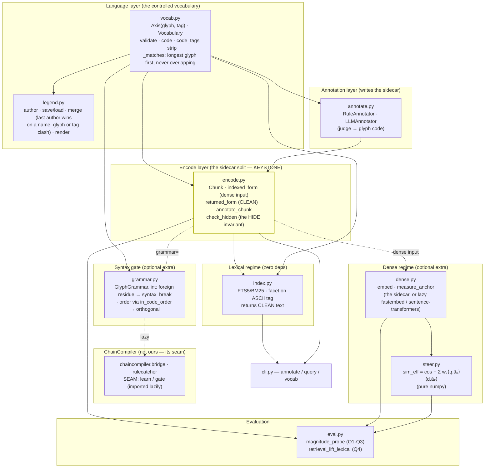
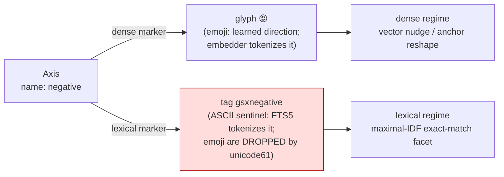
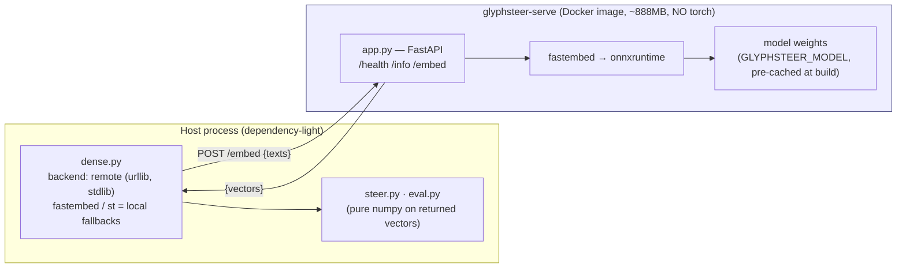

# GlyphSteer — Component Architecture

> Static structure. Update with every module/boundary change (rule 00). Arrows = depends-on.

## Whole-package component diagram

## The dual-rendering of one axis (the central finding)

## The dense sidecar (containerized neural runtime)

The heavy neural runtime lives OFF the host, in a container; the host calls it over HTTP.

- Swapping the embedding model = one env var (`GLYPHSTEER_MODEL`) → rebuild. This is what
  made the emoji-collapse failure (see DW-6) discoverable and fixable.
- The container is **embeddings-only**; all steer/probe math stays host-side on the vectors.

## Boundary notes
- `vocab._matches` is the **only** way a glyph is found in text: left to right, at each place the
  longest glyph that starts there, never two that overlap. `parse`, `glyphs_in`, `code_tags`,
  `strip`, `in_code_order`, `to_honeyc` and the grammar's order check all read through it, so a
  vocabulary may hold a glyph that is part of another (an emoji and its VS16 or skin-tone form).
- `encode.py` is the **only** place the indexed-form/returned-form split is defined; the
  HIDE invariant (`check_hidden`, `index.assert_hidden`) is enforced at every read boundary.
- `grammar.py` imports ChainCompiler's bridge and rulecatcher inside `_deps()`, so importing
  GlyphSteer never needs them; its `lint` refuses foreign content itself, before the tag chain
  rulecatcher reads is built.
- `dense.py` is the **only** import of an embedding runtime (`fastembed`, `sentence-transformers`), each lazy, so the
  whole left side runs with the package installed from its folder and no extra (`pip install -e packages/glyphsteer`;
  glyphsteer is not on PyPI — ChainCompiler `DESIGN.md` §18).
- `steer.py` is **pure numpy** — it takes vectors, never the model, so the metric math is
  testable without any download.
